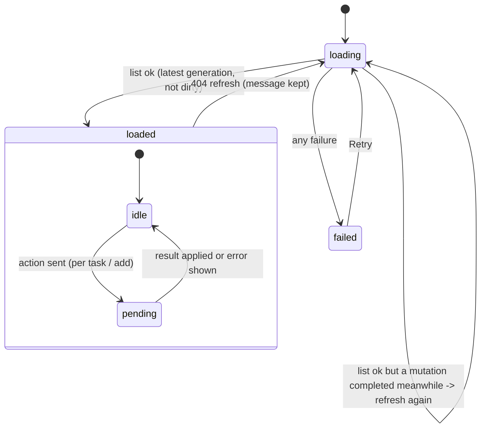
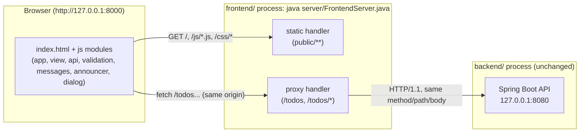
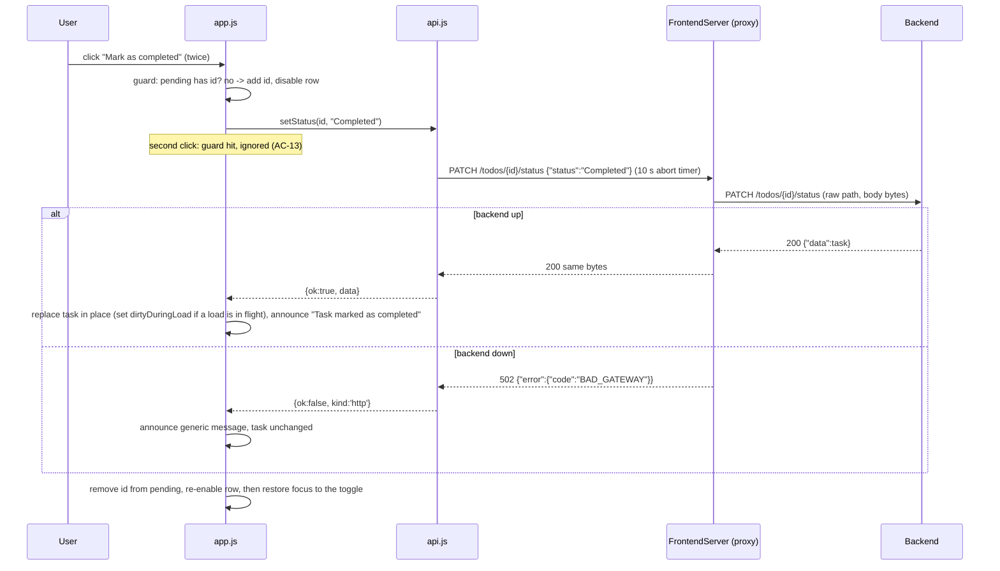

# Architecture - CAP-1: Todo App - Frontend: Task management user interface

Status: FINAL (attempt 3, revised after design review round 1). D-1, D-2 and D-9 were decided by the human in "Stage 2 clarifications, round 1" (S2-1..S2-3); they are ratified at G2 (section 14).       Inputs: requirements.md (FINAL, G1 approved), repo-profile.md, clarifications.md (H-1..H-3, Q-1..Q-6, S2-1..S2-3), approvals.md, design-review.md (round 1, REVISE), `backend/README.md`, `docs/sdlc/CAP-2/requirements.md` Appendix A

Revision note (attempt 2): the human's S2-1..S2-3 answers have been applied. The runtime is decided (D-1, S2-1). The
agent `java` permissions are the human's stated intention for his own `.claude/settings.local.json` and are not yet
in place (S2-2). The browser self-test page and the manual checklist are run by the human, and their results are
HUMAN-REPORTED (S2-3). The human did not paste `java -version`, so `java` on `PATH` remains unconfirmed (R-1).

Revision note (attempt 3): every design-review finding DR-1..DR-11 is accepted and applied with local edits; see
section 16 for where each one is addressed. Review question Q-1 (an optional repository-root permission entry) was
answered by the Orchestrator with the default **no**: S2-2 stays as decided, and B falls back to human-run or NOT_RUN
when the agent's command form does not match (R-10, R-11). No requirement, decision G2-1..G2-3 or technology changed.

## 1. Summary
This is a single-page UI made of plain HTML, CSS and native ES modules with no build step (H-C1). It lives in
`frontend/public/` and is served by one Java file, `frontend/server/FrontendServer.java` (decided by the human, S2-1).
That file runs on the already-installed JDK 25 in source-launch mode. You start it from `frontend/` with
`java server/FrontendServer.java` on port 8000, so it needs no Maven module and no dependency. The server sends the
static files and forwards `/todos` and `/todos/*` unchanged to `127.0.0.1:8080` (H-C2). The page and the API
therefore share one origin, which gets around the backend's lack of CORS (NFR-1). `backend/` is not touched.

The JavaScript is split into small modules:
- pure logic: validation, the API client with its error classification, and message mapping;
- DOM rendering;
- a controller that holds the state, the per-task pending flags, the ordering of responses and the focus rules.

The browser APIs (`fetch`, timers, the announcer's deferral) are injected. That lets a dependency-free self-test page
exercise every behavioural AC deterministically in a real browser. The proxy is tested by a black-box test that uses
only the JDK. A short scripted checklist covers end-to-end runs against the real backend.

Who runs what (decided):
- The human runs the self-test page and the checklist and pastes the results, which are **HUMAN-REPORTED** (S2-3).
- An agent runs the proxy test only if the human's `java` permission entries exist when Stage 5 starts and the
  agent's command form matches them. Otherwise the human runs it (HUMAN-REPORTED) or it is reported NOT_RUN (S2-2).

## 2. Architecture drivers
| Rank | Requirement ids | Why it drives the design |
|---|---|---|
| 1 | NFR-1, AC-23, H-C2 | The backend has no CORS and answers OPTIONS with 405. The page must share an origin with `/todos`, so a transparent proxy is mandatory. Its runtime is limited to confirmed tooling (D-1, decided S2-1) |
| 2 | H-C1 (no build step), confirmed tooling only | This rules out frameworks, bundlers and npm test runners. It shapes the module format (native ES modules) and the test strategy (D-2, decided S2-3) |
| 3 | FR-10, FR-9, AC-11, AC-12, AC-15, AC-20, AC-22, requirements 7.3 | The UI changes only on a confirmed backend response, and an older response never overwrites a newer confirmed one. Every response class maps to exactly one user-visible outcome, so there is one classifier and one mapping table |
| 4 | FR-11, AC-13, AC-19 | Per-task pending state, and a guard against duplicate submissions that is logical, not only visual |
| 5 | NFR-3, AC-14, FR-5 (dialog) | Live regions (including for field errors), focus management after every success and failure, a modal with a focus trap, and no colour-only cues |
| 6 | NFR-2, AC-21 | Text is only ever inserted with `textContent` or `createTextNode`. CSS keeps the line breaks |
| 7 | FR-7, AC-5, AC-6, AC-16, AC-17 | The trim and code-point count must match the backend exactly (`UnicodeText.java`). JS `String.prototype.trim` does not match (D-6) |

## 3. Existing system analysis
- Relevant modules and their paths: `backend/` (Spring Boot API with routes `/todos`, `/todos/{id}` and
  `/todos/{id}/status`; see `backend/src/main/java/com/capstone/todo/web/ApiRoutes.java` and `TodoController.java`).
  There is no frontend code.
- Patterns and conventions to follow:
  - Envelopes are `{"data":...}` and `{"error":{"code","message","details"}}`. The content type is `application/json`
    with no charset (`web/response/ApiResponses.java:26`).
  - Text rules: trim by the 25 `White_Space` code points and count code points (`validation/UnicodeText.java:17-51`).
  - Strings containing unpaired surrogates are rejected as `INVALID_REQUEST_BODY` (`web/request/JsonBodyReader.java:85-98`).
  - The field messages match the UI wording exactly (`validation/TaskRequestValidator.java:38-43`).
  - Each module has its own README as run documentation (`backend/README.md`).
  - Changelog entries go under `Unreleased` (`docs/changelog.md:3-6`).
  - Commits are `<KEY>: <summary>`. Branches are `feature/<KEY>-<slug>` (git log).
- Reusable code: nothing can be reused directly, because the frontend cannot import Java code.
  - The backend's `UnicodeText` rule is re-implemented in JS as a copy of the specification (D-6).
  - The JDK-only raw-HTTP test follows the idea of `backend/src/test/java/com/capstone/todo/support/RawHttp.java`. The
    class itself is not reused, because it sits inside the Maven test tree.
- Constraints from the repo:
  - There is no CI (repo-profile 5).
  - The shared `.claude/settings.json:44-55` allows no `java` command. Agent `java` permissions depend on the human's
    own `.claude/settings.local.json` (S2-2; the entries are not yet added).
  - The current branch `Main` is protected (`.claude/hooks/protected-branches.txt`).
  - The developer may write to `frontend/` in Stage 5 (`.claude/hooks/agent-paths.conf:15`).
  - The backend listens on `127.0.0.1:8080` (`backend/README.md:45`).
  - The backend is started from `backend/` (`backend/README.md:10-15`).

## 4. Technology choices
| Concern | Choice | Evidence / justification | New to the repo? |
|---|---|---|---|
| UI language and format | HTML5, CSS and JavaScript as native ES modules (`<script type="module">`). No build, no framework, no dependency | H-C1 (requirements 7.1, G1). ES modules load directly in the target browsers (NFR-4: latest 2 versions of Chrome, Edge, Firefox and Safari) | yes (decided by the human, Q-1) |
| Static server and proxy runtime | JDK 25 source launcher: `java server/FrontendServer.java`, run from `frontend/`, port 8000. Uses only `com.sun.net.httpserver` (module `jdk.httpserver`), `java.net.http.HttpClient` (module `java.net.http`) and `java.nio.file` | **Decided by the human (S2-1).** JDK 25.0.5.1 is confirmed by a recorded execution (`docs/sdlc/CAP-2/verification-report.md:48-60`). No package, Maven module or build tool. Node.js and Python are not confirmed (repo-profile 3). Whether `java` is on `PATH` is unconfirmed, so the README also documents the `JAVA_HOME` form (R-1) | a new program, but no new technology (the JDK already runs the backend) |
| Proxy-server test | `java server/FrontendServerTest.java`, run from `frontend/`. A black-box test using only the JDK: it starts the server as a child JVM and runs a stub backend in-process | JDK only. JUnit is not used, because it would need Maven or a module. This follows the backend's practice of raw-HTTP contract tests | a new file, no new technology. The runner depends on S2-2 (section 10.1) |
| UI behaviour tests | A dependency-free self-test page, `frontend/public/tests/index.html`, with an assertion harness of about 60 lines, run in a real browser | JDK 25 ships no JS engine (Nashorn was removed in JDK 15). Any JS runner (Node, Playwright, Selenium) would be a new toolchain | new files, no new technology. **Run by the human, HUMAN-REPORTED (S2-3)** |
| End-to-end check | A scripted manual checklist in `frontend/README.md`, run against the real backend | AC-23 needs both real processes and a browser | no. **Run by the human, HUMAN-REPORTED (S2-3)** |

## 5. Decisions
| ID | Decision | Options considered | Choice and reason | Trade-offs |
|---|---|---|---|---|
| D-1 | Runtime of the static server and proxy (requirements 7.1.1 D-1). **Decided by the human (S2-1)** | (a) JDK 25 single-file source launch with the built-in `HttpServer` and `HttpClient`. (b) Node.js `http` module. (c) Python `http.server` plus a hand-written proxy. (d) A Maven module or Spring app in `frontend/` | **(a)**, as the architect recommended and the human chose. It is the only runtime with recorded execution evidence. It needs no install, no dependency and no build step (`java X.java` compiles in memory), and it leaves `backend/` untouched. (b) and (c) are not confirmed. (d) would add a build and dependencies to something meant to stay small | In-memory compilation adds an unmeasured start-up delay. `com.sun.net.httpserver` is a basic API, though it is exported and supported by the JDK. An agent can run it only with the permissions from S2-2. `java` on `PATH` is unconfirmed (R-1) |
| D-2 | Functional testing of the UI with no build step and confirmed tooling only. **Decided by the human (S2-3)** | (A) Pure-logic and DOM tests on a self-test page in a real browser, with injected fake `fetch` and timers. (B) A JDK-only black-box test of the server and proxy. (C) Real-browser automation (Playwright or Selenium, or WebDriver with a downloaded driver). (D) A scripted manual checklist against the real backend. (E) The Node built-in test runner for the pure modules. (F) An agent runs an installed browser headless on the self-test page | **B + A + D.** B uses only the JDK and covers the proxy (NFR-1 transport, 502 when the backend is down). A covers AC-1..AC-22 behaviourally (DOM text, disabled state, focus, live regions, dialog, the exact requests sent) with nothing to install. D covers AC-23, the real-backend flow and the screen-reader and browser checks. **The human runs A and D and pastes the results, which are HUMAN-REPORTED (S2-3).** B is run by an agent only if the S2-2 permissions exist (section 10.1). C and E need new toolchains, and F was not adopted | AC-1..AC-22 rest on HUMAN-REPORTED evidence and no agent can re-run them (R-4). A uses fakes, so it does not prove the backend contract; B and D cover that |
| D-3 | Module structure of the JS | (a) One `app.js`. (b) Small modules with injected browser APIs | **(b)**. The pure logic (validation, classification, mapping) can be tested, and the app can be mounted in a sandbox for test A | More files. They are all native modules, so there is no build cost |
| D-4 | Rendering strategy | (a) Re-render the whole list on every change. (b) Keyed rows (`data-id`) updated in place. A full render happens only on the initial load; a refresh or Retry reconciles by id (8.1, "Load") | **(b)**. Focus, the caret and the edit-form text stay intact, also through a refresh (AC-11, AC-22), and the other tasks stay usable while one task is pending (AC-19) | Slightly more view code (a keyed reconcile) |
| D-5 | Delete confirmation | (a) `window.confirm` (ruled out by Q-5(b)). (b) Native `<dialog>` with `showModal()`, plus an explicit Tab trap and focus return. (c) A hand-built `div` modal | **(b)**. The target browsers support it (NFR-4). It makes the rest of the page inert by default, and Escape maps to decline. The explicit trap, the single resolution on `close` and the focus return make the behaviour the same in every browser (8.2) | Native `<dialog>` behaviour in the oldest supported Safari is not verified (R-5) |
| D-6 | Trim and length rule in the UI | (a) `String.prototype.trim()` and `.length`. (b) A copy of the backend's 25-code-point `White_Space` set, with code-point counting (`[...s].length`) | **(b)**. JS `trim()` removes U+FEFF, which the backend keeps, and does not remove U+0085, which the backend strips. `.length` counts UTF-16 units, so an emoji would count as 2. Either would break AC-16 and AC-17 parity | The rule exists twice (Java and JS). Mitigation: test A holds a table of test vectors copied from `UnicodeText.java`, including the named vectors where the JS built-ins and the backend differ (10.1 row A) |
| D-7 | Request timeout (NFR-6) | (a) None. (b) `AbortController` with a 10 000 ms timer per request in the API client | **(b)**. The timer is armed before `fetch` and cleared only after `response.text()` has settled, so a stalled body also ends as a timeout. The timer function is injected, so test A can fire it at once and check the generic-message path | The 10-second limit itself is NOT_RUN by H-2. Only the logic that turns an abort into a failure is tested |
| D-8 | Web root and test placement | (a) One root, `frontend/public/`, that also holds `tests/`. (b) Two mounts (`/` and `/tests/`) | **(a)**. A single mapping keeps the server minimal (H-1). Deployment is out of scope (A-10) | The test files are served next to the app. That is acceptable for local use only |
| D-9 | Ports. **Port 8000 decided by the human (S2-1)** | The server defaults to port 8000, overridable with `--port=<n>`. The backend port defaults to 8080, overridable with `--backend-port=<n>`. The host is fixed at `127.0.0.1` | 8000 is the human's decision (S2-1). 8080 is fixed by A-12. `--backend-port` exists only so test B can point the proxy at a stub backend on a free port | If 8000 is in use, the server exits with a clear message and the user passes `--port` (R-7) |
| D-10 | Dialog, pending and button wording that the requirements leave open | Proposed wording in section 6.3 | Every 7.3 message is used word for word. Only the control labels that the requirements leave open are proposed | The design review or G2 may change the wording |

## 6. Components and responsibilities
| Component | Responsibility | New / changed / reused | Path |
|---|---|---|---|
| C-1 Frontend server and proxy | Serve `frontend/public/**` (GET and HEAD, regular files only, correct MIME types, `/` maps to `index.html`, a directory without a trailing slash is redirected, `Cache-Control: no-store`). Forward `/todos` and `/todos/*` to `127.0.0.1:<backend-port>` unchanged. Answer 502 or 504 when the backend cannot be reached or the request cannot be forwarded; never drop the connection (7.3). Bind to `127.0.0.1` only | new | `frontend/server/FrontendServer.java` |
| C-2 Page shell | Static markup: the heading, the message area (two live regions), the add form, the list region, the list status (loading, error with Retry, empty state) and a `<dialog>` for delete. `<link rel="icon" href="data:,">` so the browser does not request `/favicon.ico` | new | `frontend/public/index.html` |
| C-3 Styles | Layout; a visible `:focus-visible` outline; a Completed style that does not rely on colour (a text badge plus strike-through); borders on error and success messages; `white-space: pre-wrap` for descriptions; a visually-hidden helper | new | `frontend/public/css/styles.css` |
| C-4 Bootstrap | Create the real API client (`window.fetch`, `setTimeout`) and mount the app on `#app` | new | `frontend/public/js/main.js` |
| C-5 API client | Build requests (paths, headers, JSON body). Enforce the 10 s timeout, kept armed through `response.text()`. Classify every outcome into a `Result` (section 7.2). No DOM | new | `frontend/public/js/api.js` |
| C-6 Validation | Trimming (backend `White_Space` set), code-point length, and the field rules and messages for add and edit. Pure | new | `frontend/public/js/validation.js` |
| C-7 Outcome mapping | Map (operation, `Result`) to a UI outcome: message text, message kind, field errors and a refresh flag. Implements requirements 7.3. Pure | new | `frontend/public/js/messages.js` |
| C-8 Controller and state | Hold the state (section 8). Handle user intents. Guard against duplicates. Order concurrent responses (load generation and dirty flag, 8.1). Call C-5, C-6 and C-7. Apply only confirmed results. Decide where focus goes after success and failure. Drive C-9 | new | `frontend/public/js/app.js` |
| C-9 View | Create and update the DOM nodes for the list, the rows, the inline edit form, the list status and the orphaned-draft panel. Keyed reconcile by `data-id` that never rebuilds the row in edit mode. Uses only `textContent`, `createElement`, `setAttribute`, `disabled` and `hidden`, never `innerHTML` | new | `frontend/public/js/view.js` |
| C-10 Message area | `createAnnouncer({statusEl, alertEl, defer})` (I-9). Show one message at a time, in the polite region (success) or the assertive region (error), including field-error summaries (8.2). Clear the other region. Announce identical text again when it repeats. The deferral function is injected; the default is `fn => setTimeout(fn, 50)`, which still fires in a background tab, and test A injects a manual flush | new | `frontend/public/js/announcer.js` |
| C-11 Confirm dialog | Open the `<dialog>` with the task title. Return a promise of `true` (confirm) or `false` (Cancel or Escape) that resolves exactly once, on the `close` event. A call while the dialog is open returns the pending promise. Trap Tab. The caller supplies the element that gets focus back | new | `frontend/public/js/dialog.js` |
| C-12 Browser self-test page | A harness (`describe`, `it`, `assert`, async support), a fake `fetch` that records requests and can hold responses until released (for ordering tests), a fake timer, a manual announcer flush and a sandbox mount. Shows `N passed, M failed` and a `<pre id="results">` summary for the human to paste verbatim (S2-3). Has the same `data:` favicon link as C-2 | new (test) | `frontend/public/tests/index.html`, `tests/harness.js`, `tests/*.test.js` |
| C-13 Proxy and server test | A black-box JDK test: free ports, an in-process stub backend (`HttpServer`) that records requests and sends scripted responses, the server started as a child JVM, and `HttpClient` assertions. Robustness rules in 10.1 row B (directory discovery, `java.home` launcher, readiness wait, output drain, destroy in `finally`, overall timeout). Prints PASS or FAIL for each case and exits non-zero on any failure | new (test) | `frontend/server/FrontendServerTest.java` |
| C-14 Run documentation and checklist | The start order (backend first). The start command in both forms: `java server/FrontendServer.java`, plus the `JAVA_HOME` form for when `java` is not on `PATH` (R-1). The URL. How to run tests A, B and D, and what to paste back (the self-test summary line and the `<pre id="results">` block, the checklist results, the browsers used). The manual end-to-end checklist, which notes that any unrelated console 404 is not a CORS error. What remains unverified | new | `frontend/README.md` |
| C-15 Changelog entry | A CAP-1 line under `Unreleased` | changed (pr-manager) | `docs/changelog.md` |

### 6.1 File layout
```
frontend/
  README.md                      C-14
  server/
    FrontendServer.java          C-1  (run from frontend/: java server/FrontendServer.java [--port=8000] [--backend-port=8080])
    FrontendServerTest.java      C-13 (run from frontend/: java server/FrontendServerTest.java; also works from the repo root)
  public/                        web root (only this directory is served)
    index.html                   C-2
    css/styles.css               C-3
    js/main.js                   C-4
    js/api.js                    C-5
    js/validation.js             C-6
    js/messages.js               C-7
    js/app.js                    C-8
    js/view.js                   C-9
    js/announcer.js              C-10
    js/dialog.js                 C-11
    tests/index.html             C-12 (open http://127.0.0.1:8000/tests/; /tests redirects there)
    tests/harness.js, tests/fakes.js
    tests/validation.test.js, api.test.js, messages.test.js, app.test.js
```
The two run commands must stay exactly `java server/FrontendServer.java` (optionally followed by arguments) and
`java server/FrontendServerTest.java` with no arguments. Those are the forms in the S2-2 permission entries
(`Bash(java server/FrontendServer.java*)`, `Bash(java server/FrontendServerTest.java)`). C-13 therefore needs no
command-line arguments: it picks free ports itself and finds `frontend/` itself (10.1 row B).

Module dependencies run one way only. `main` uses `app` and `api`. `app` uses `validation`, `messages`, `view`,
`announcer` and `dialog`. `api`, `validation` and `messages` import nothing.

### 6.2 UI structure (one screen, Q-5(d))
- `<main id="app">` contains, in this order:
  - `<h1>Tasks</h1>`;
  - the message area, `<div class="messages">`, which holds `<p id="msg-status" role="status" aria-live="polite" aria-atomic="true">` and `<p id="msg-alert" role="alert" aria-atomic="true">`. The two look like one message region, and only one has text at a time;
  - the add form, `<form id="add-form" novalidate>`:
    - `<label for="add-title">Title</label><input id="add-title" aria-describedby="add-title-error">`. There is deliberately no `maxlength`, because `maxlength` counts UTF-16 units and would stop AC-6 from showing its message;
    - `<p id="add-title-error" class="field-error">`;
    - `<label for="add-description">Description (optional)</label><textarea id="add-description">` and its error `<p>`;
    - `<button type="submit">Add task</button>`;
  - `<section aria-labelledby="list-heading">`, holding `<h2 id="list-heading" tabindex="-1">Your tasks</h2>`, then `<p id="list-status">` (loading, empty state or load error), `<button id="retry" hidden>Retry</button>`, `<div id="orphan" hidden>` (section 8.4) and `<ul id="task-list">`;
  - `<dialog id="confirm-dialog" aria-labelledby="confirm-title" aria-describedby="confirm-text">`.
- A task row `<li data-id>` in view mode shows:
  - the title (`<h3>`, text);
  - the description (`<p class="desc">`, text), only if it is not empty;
  - a status badge with the text "Pending" or "Completed". Completed also gets a strike-through title and a different border, so colour is never the only cue;
  - the buttons "Edit", "Mark as completed" or "Mark as pending", and "Delete". Each button has an accessible name that includes the title, such as "Delete: <title>" (an `aria-label` set with `setAttribute`), and a stable `data-action`.
- A task row in edit mode (only one at a time, Q-5(e)) shows:
  - an inline `<form>` with a labelled Title input and Description textarea, pre-filled from the task in state, each with its error `<p>`;
  - the buttons "Save" and "Cancel". Escape inside the form acts as Cancel.

### 6.3 Proposed wording not fixed by the requirements (D-10)
- Loading: "Loading tasks...".
- Pending button text: "Adding...", "Saving...", "Updating..." and "Deleting...".
- Dialog: the heading "Delete task?", the text `Delete "<title>"? This cannot be undone.` (the title is inserted as text) and the buttons "Delete" and "Cancel".
- Load-failure text in `#list-status`: "Something went wrong. Please try again." with Retry (the generic message from 7.3).
- Empty state: "No tasks yet".

## 7. Interfaces and contracts
| Interface | Producer -> consumer | Inputs | Outputs | Errors and failure modes |
|---|---|---|---|---|
| I-1 HTTP static | C-1 -> browser | `GET` or `HEAD` on `/` or `/<file>` under `public/` | 200 with the content type from section 7.3. `/` and `/tests/` map to `index.html`. A directory path without a trailing slash (for example `/tests`) gets 301 with `Location: <path>/` | 404 `text/plain` for a missing file, a path that is not a valid file name, a non-regular file, a directory without `index.html` or a path outside the root. 405 `text/plain` for other methods |
| I-2 HTTP proxy | browser -> C-1 -> backend | any method on `/todos` or `/todos/...`, with the raw path and query | the backend's status, `Content-Type` and body bytes, unchanged | Backend unreachable, connect timeout, a request that cannot be built, or an interrupt: 502 `application/json` `{"error":{"code":"BAD_GATEWAY","message":"Backend unavailable"}}`. 30 s request timeout: 504 with code `GATEWAY_TIMEOUT`. The UI maps any 5xx to the generic message |
| I-3 Backend REST | C-5 -> backend (through I-2) | requirements 7.2 | requirements 7.2 | requirements 7.3, plus a non-JSON `400 text/html` (AC-20) from Tomcat or a `400` from the JDK server itself (7.3) |
| I-4 `createApiClient({fetchFn, setTimer, clearTimer, timeoutMs=10000})` | C-4 -> C-8 | `listTasks()`, `createTask({title, description})`, `replaceTask(id, {title, description})`, `setStatus(id, status)`, `deleteTask(id)` | `Promise<Result>`, which never rejects (section 7.2) | every failure is folded into the `Result` |
| I-5 `validateTask({title, description})` | C-6 -> C-8 | the raw input strings | `{ok, value:{title, description}, errors:{title?, description?}}`, with trimmed values | none (pure) |
| I-6 `outcomeFor(operation, result)` | C-7 -> C-8 | operation is one of `list`, `add`, `edit`, `status`, `delete` | `{kind:'success'|'error', message, fieldErrors:{title?, description?}, refresh:boolean}` | none (pure) |
| I-7 `confirmDelete(title)` | C-11 -> C-8 | the title text | `Promise<boolean>`, resolved once on `close`. A call while open returns the same pending promise | none. Escape or Cancel resolve to `false` |
| I-8 `createApp({root, api, confirm?, announcer?})` | C-8 | a DOM root and an I-4 implementation | the mounted app plus a `ready` promise (used by the tests) | none |
| I-9 `createAnnouncer({statusEl, alertEl, defer = fn => setTimeout(fn, 50)})` | C-10 -> C-8 | `announce(kind, text)`, `clear()` | none | none. Test A passes a `defer` that queues callbacks until the test flushes them |

### 7.1 Requests built by C-5 (A-6, A-7)
| Operation | Method and path | Headers | Body |
|---|---|---|---|
| list | `GET /todos` | `Accept: application/json` | none |
| add | `POST /todos` | `Content-Type: application/json`, `Accept` | `JSON.stringify({title, description})`, with the trimmed values only |
| edit | `PUT /todos/${encodeURIComponent(id)}` | same | `{title, description}`; both are always sent |
| status | `PATCH /todos/${encodeURIComponent(id)}/status` | same | `{"status":"Completed"}` or `{"status":"Pending"}` |
| delete | `DELETE /todos/${encodeURIComponent(id)}` | `Accept` | none (no `Content-Type`) |

The `id` always comes from a task that the server returned. It is never built from user text (A-6). The paths are
relative to the page's own origin, so they carry no host (A-13).

### 7.2 Result classification (C-5): the API client's error mapping
Every response is read with `response.text()` (UTF-8) and then passed to `JSON.parse` inside a `try`. The abort timer
is armed before `fetch` and cleared in a `finally` only after `text()` has resolved or rejected (D-7). Classification
works in this order:
1. If `fetch` or `text()` rejects because of the abort timer, the result is `{ok:false, kind:'timeout'}`. Any other rejection gives `{ok:false, kind:'network'}`.
2. Status 204 on a `delete` gives `{ok:true, data:null}`. A 204 on any other operation gives `{ok:false, kind:'unexpected'}`.
3. A 2xx status gives `{ok:true, data}` when all of these hold:
   - the code is the right one for the operation (200 for list, edit and status; 201 for add);
   - the body parses as an object that has `data`;
   - `data` passes the shape check.

   A task passes the shape check when `id` is a non-empty string, `title`, `description` and `status` are strings,
   and `status` is `Pending` or `Completed`. For a list, `data` must be an array of such tasks. Any other 2xx (wrong
   code for the operation, non-JSON or wrong shape) gives `{ok:false, kind:'unexpected'}` (AC-20).
4. A non-2xx status with an `{"error":{"code":string}}` envelope is classified by its code:
   - 400 `VALIDATION_ERROR` gives `{ok:false, kind:'validation', details}`. `details` keeps only the entries whose `field` and `message` are strings. It is an empty array if `details` is missing or invalid.
   - 404 `TODO_NOT_FOUND` gives `{ok:false, kind:'notFound'}`.
   - Any other code or status gives `{ok:false, kind:'http'}`. This includes `INVALID_REQUEST_BODY`, for example for a title that holds an unpaired surrogate (`JsonBodyReader.java:85-98`); no client-side rule is needed for that case.
5. A non-2xx status without a parseable envelope (Tomcat or JDK-server HTML, proxy text, an empty body) gives `{ok:false, kind:'http'}`.

C-7 maps results to outcomes (requirements 7.3). Codes, status numbers and the raw `error.message` are never shown.
| Result kind | list | add / edit | status | delete |
|---|---|---|---|---|
| ok | render the list. Initial load and Retry clear any message; a refresh (8.1 "Load", reason `refresh`) keeps the current message | "Task added" / "Task updated" (success) | "Task marked as completed" / "Task marked as pending" | "Task deleted" |
| validation, with `title` or `description` entries | generic (cannot occur) | each entry's `message` goes beside its field. If any entry names another field, "Please check your input and try again." is also shown | "Please check your input and try again." | generic |
| validation, with no usable entries | generic | "Please check your input and try again." | "Please check your input and try again." | generic |
| notFound | generic | add: generic. Edit: "This task no longer exists", with `refresh:true` | "This task no longer exists", with `refresh:true` | "This task no longer exists", with `refresh:true` |
| http, network, timeout, unexpected | generic ("Something went wrong. Please try again.") with Retry. On a refresh, the generic text and Retry go in `#list-status` only (8.1) | generic | generic | generic |

Every error outcome keeps the displayed list and the typed text (AC-11). Field errors (client-side validation or
validation entries for title and description) appear beside their fields with `aria-invalid` and `aria-describedby`,
**and** their text is also written to `#msg-alert` through C-10: the field messages in field order (title, then
description), separated by a space, followed by "Please check your input and try again." when an entry names another
field. The alert is what makes the error audible when focus is already on the field, for example after pressing Enter
in the title input (AC-14). Focus then moves to the first invalid field.

### 7.3 Frontend server and proxy design (C-1)
- **Start:** from `frontend/`, run `java server/FrontendServer.java [--port=8000] [--backend-port=8080]`.
  - If `java` is not on `PATH`, use `"$JAVA_HOME/bin/java" server/FrontendServer.java` in Git Bash or
    `"%JAVA_HOME%\bin\java" server\FrontendServer.java` in cmd. The README documents both (R-1). The `JAVA_HOME` form
    is not covered by the S2-2 permission entries, so only a human can use it.
  - The web root is `./public`, resolved against the working directory, made absolute and normalised (`toAbsolutePath().normalize()`). The rule is the same as in `backend/README.md:10-15`.
  - If `./public/index.html` is missing, the server exits non-zero with a one-line message ("run from the frontend/ directory").
  - It binds `HttpServer` to `127.0.0.1:<port>`. If the port is in use, it exits non-zero with a message that names the port and the `--port` option.
  - At start-up it prints one line: `Frontend at http://127.0.0.1:<port>/ - proxying /todos to http://127.0.0.1:<backend-port>`. Test B waits for this line (10.1 row B).
  - Executor: `Executors.newVirtualThreadPerTaskExecutor()` (JDK 21+), so a slow backend call never holds up static files.
- **Routing:** a request is proxied when its raw path is exactly `/todos` or starts with `/todos/`. `/todosx` is not
  proxied and gets a static 404. Everything else is served as a static file.
- **Forwarding:**
  - Method: the same method token is sent through `HttpRequest.Builder.method(name, publisher)`, whatever the method (the backend answers 405 itself).
  - URI: `http://127.0.0.1:<backend-port>` + `exchange.getRequestURI().getRawPath()`, plus `?` + `getRawQuery()` when there is a query. The proxy never decodes and re-encodes the path. A request target with a malformed percent sequence (`%zz`, a lone `%`) may be rejected by the JDK `HttpServer` itself (probably with a `400`) before any handler runs (**UNVERIFIED**). Whatever happens, the UI maps it to the generic message (7.2 step 5). The observable behaviour is recorded in Stage 7 if anyone exercises it; it is not promised.
  - Request headers: only `Content-Type` and `Accept` are copied. Hop-by-hop headers, `Host`, `Content-Length`, `Connection` and `Origin` are not copied; `HttpClient` sets its own. No `X-Forwarded-*` headers are added, because the backend does not need them.
  - Body: the request body is read fully (`readAllBytes`) and sent with `BodyPublishers.ofByteArray`, or with `noBody()` when it is empty. The proxy sets no size limit; the backend enforces 65 536 bytes with a 413.
  - Client: one shared `HttpClient`, with `version(HTTP_1_1)` (avoids an h2c upgrade attempt over plain HTTP), `connectTimeout(5 s)`, a request `timeout(30 s)` (longer than the browser's 10 s, so the browser's limit always applies first) and `followRedirects(NEVER)`.
- **Response pass-through:**
  - The status code is passed on unchanged.
  - The `Content-Type` value, when present, is copied unchanged (including `text/html` from Tomcat). No other response header is copied. The proxy adds `Cache-Control: no-store`.
  - The body bytes are passed on unchanged. For a 204 or an empty body, the call is `sendResponseHeaders(status, -1)`. Otherwise the exact byte length is used, never 0, because 0 means chunked in `HttpServer`.
- **Failures (catch order matters):** the whole handler body is one `try`, with the catches in this order, because
  `HttpConnectTimeoutException` is a subclass of `HttpTimeoutException` (**UNVERIFIED** from the repo; JDK API):
  1. `HttpConnectTimeoutException` gives 502 (`BAD_GATEWAY`, the JSON body from I-2).
  2. `HttpTimeoutException` (the 30 s request limit) gives 504 with the same envelope and the code `GATEWAY_TIMEOUT`.
  3. `IOException` (including `ConnectException`) gives 502.
  4. `InterruptedException` gives 502, and the handler calls `Thread.currentThread().interrupt()` to restore the flag.
  5. `IllegalArgumentException` (from `URI.create`, or from `HttpRequest.Builder` for an odd raw path or a method token such as `CONNECT`) gives 502.
  6. Any other `RuntimeException` gives 502.

  An error response is sent only if response headers have not been sent yet. A `finally` always calls
  `exchange.close()`, so the browser never sees a dropped connection from an unhandled exception. One line goes to
  stderr: `proxy: <METHOD> <route kind> failed: <exception class>`. Path ids, bodies and titles are never logged. This
  mirrors `backend/README.md:107-108`. The static handler follows the same `try`/`finally` rule.
- **Static files:**
  - The path is `exchange.getRequestURI().getPath()`, which `java.net.URI` has already percent-decoded once (as UTF-8) and which, unlike `URLDecoder`, does not turn `+` into a space.
  - The leading `/` is stripped before resolving, because resolving `/js/main.js` against the root on Windows gives a drive-root path (**UNVERIFIED**; `java.nio` behaviour). An empty remainder means `index.html`.
  - The file is `root.resolve(rest).normalize()`. It must still start with the root, or the answer is 404. `InvalidPathException` (characters such as `:`, `*`, `?`, `"`, `<`, `>`, `|` or NUL on Windows) gives 404.
  - A directory: if the request path does not end in `/`, the answer is 301 with `Location: <path>/` and no body (so `/tests` becomes `/tests/`, and the relative module imports of the self-test page resolve correctly). If it does end in `/`, its `index.html` is served when that is a regular file; otherwise 404.
  - Only regular files (`Files.isRegularFile`) are served; anything else is 404. Files are read with `Files.readAllBytes`. `HEAD` sends the headers only.
  - MIME map:
    - `.html`: `text/html; charset=utf-8`;
    - `.css`: `text/css; charset=utf-8`;
    - `.js`: `text/javascript; charset=utf-8`. This one is required, because browsers refuse to load module scripts with the wrong MIME type;
    - `.svg`: `image/svg+xml`; `.ico`: `image/x-icon`; `.png`: `image/png`;
    - anything else: `application/octet-stream`.
  - `Cache-Control: no-store` is sent.
- **Stop:** Ctrl+C. The server keeps no state and writes no files.

## 8. Data model and data flow
The frontend owns no persistent data. The backend is the source of truth (FR-10). Nothing is written to
`localStorage`, cookies or files.

State held in memory by C-8:
```
tasks: Task[]                 // backend order; set on load/refresh; add -> unshift (or replace if the id is present); edit/status -> replace in place by id; delete -> remove by id
loadStatus: 'loading' | 'loaded' | 'failed'
loadGen: number               // incremented by every load; a list response from an older generation is ignored
dirtyDuringLoad: boolean      // a mutation succeeded while a load was in flight (DR-2 rule, 8.1)
pending: Set<'add' | taskId> // per-task / add-form pending (FR-11)
editing: null | { id, draftTitle, draftDescription }   // one task at a time; drafts updated on every `input` event
fieldErrors: { add: {...}, edit: {...} }
orphan: null | { title, description }                  // AC-22
```

### 8.1 Flows (each applies changes only after a confirmed result)
- **Load, Retry and refresh (FR-1, FR-2, AC-1..3, AC-18).** `load(reason)` with reason `initial`, `retry` or `refresh`
  (`refresh` is used after a notFound and by the ordering rule below).
  1. Increment `loadGen` and remember it as `myGen`. Set `dirtyDuringLoad=false` and `loadStatus='loading'`. Show "Loading tasks...", hide and disable Retry, and set `aria-busy` on the list.
  2. Call `listTasks()`. When it resolves, if `myGen !== loadGen`, ignore the result (a newer load is in flight).
  3. On success:
     - If `dirtyDuringLoad` is true, do not apply this snapshot (it may predate the mutation). Keep `tasks` as they are and call `load('refresh')` again. Each extra refresh happens only because a mutation completed during the previous one.
     - Otherwise set `tasks` and reconcile the rows by id in backend order, without re-sorting (D-4): existing `<li>` nodes are reused and updated; the row in edit mode is not rebuilt (its inputs, focus and caret stay); if moving a node loses focus, focus and the selection range are restored to the element that had them. Pending rows keep their disabled state and pending text, because C-9 derives them from `pending`. If the list is empty, show "No tasks yet". The initial load builds the list in one `DocumentFragment`.
     - If the task being edited is not in the new list, its draft goes to the orphan panel as in 8.4 step 2, without a new message.
     - Message area: `initial` and `retry` clear it; `refresh` leaves it unchanged, so "This task no longer exists" stays (AC-12, AC-22).
  4. On failure: set `loadStatus='failed'`. Show the generic message and Retry in `#list-status`. **No empty state is shown.** For `initial` and `retry`, the generic message is also announced in the alert region. For `refresh`, the message area is left unchanged (it keeps "This task no longer exists" when that triggered the refresh), and the tasks already on screen stay.
- **Ordering of mutation results (FR-10, AC-4, AC-7, AC-10; DR-2).** When an add, edit, status change or delete
  succeeds, its result is applied to `tasks` at once, as in the flows below. If `loadStatus==='loading'` at that moment,
  `dirtyDuringLoad` is set to true, so the list response in flight is not applied and one more refresh runs (step 3
  above). Results that arrive after a list has been applied are applied by id against the new `tasks`: add unshifts the
  task, or replaces it if the id is already there; edit and status replace by id, and if the id is absent they call
  `load('refresh')`; delete removes by id if present.
- **Add (FR-3, AC-4, AC-5, AC-6, AC-16, AC-17).**
  1. On submit, check the guard: if `pending` has `add`, ignore the submit.
  2. Validate (C-6). If the input is invalid, show the field errors and their alert text (7.2), move focus to the first invalid field and send no request.
  3. Otherwise, remember the focused element (the title input, the description or the button) as the return target. Add `add` to `pending`. Disable the inputs and the button, set the button text to "Adding..." and set `aria-busy` on the form.
  4. Call `createTask`.
  5. On success: apply the task (unshift, ordering rule above) and insert its row first. Clear the form, announce "Task added" and focus the title input.
  6. On failure: map the result with C-7 and keep the typed text.
  7. In every case, remove `add` from `pending` and re-enable the form. After a failure, focus goes to the first invalid field if there are field errors, otherwise to the remembered return target.
- **Edit (FR-4, AC-7, AC-8, AC-22).**
  1. On Edit: if another row is in edit mode and not pending, close it without a request. Render the inline form pre-filled from `tasks` and focus Title. Every `input` event on the Title or Description field updates `editing.draftTitle` or `editing.draftDescription`.
  2. On Cancel or Escape: discard the draft and render view mode from `tasks` (unchanged, no request). Focus that row's Edit button.
  3. On Save: check the guard (`pending` has the id), then validate (invalid: field errors with alert text, focus the first invalid field, no request). If the input is valid, remember the focused element as the return target, mark the task pending (form disabled, "Saving...") and call `replaceTask`.
  4. On success: replace the task in place, leave edit mode, announce "Task updated" and focus the row's Edit button.
  5. On notFound: see 8.4.
  6. On any other failure: keep the form and its text, show the outcome, re-enable the form and focus the first invalid field if there are field errors, otherwise the remembered return target (Save, or the field that had focus).
- **Status (FR-6, AC-10).**
  1. On toggle: check the guard, mark the task pending (that row's buttons disabled, toggle text "Updating...") and call `setStatus(id, next)`.
  2. On success: replace the task in place, announce the matching message and keep focus on the row's toggle button, re-focusing it after the update.
  3. On notFound: see 8.4. On any other failure: the task is unchanged, the outcome is shown, the row is re-enabled and focus returns to its toggle button.
- **Delete (FR-5, AC-9).**
  1. On Delete: check the guard, then `await confirm(title)`.
  2. On `false`: nothing changes, no request is sent and focus returns to the Delete button.
  3. On `true`: mark the task pending ("Deleting...") and call `deleteTask`.
  4. On success (204): remove the row and announce "Task deleted". Move focus to the next row's Edit button; if there is no next row, to the previous row's; if there is neither, to `#list-heading`.
  5. On notFound: see 8.4. On any other failure: the row stays, it is re-enabled and focus returns to its Delete button.
- **Focus after failure (all flows):** focus is always set after the controls have been re-enabled, in every branch,
  because a browser may move focus to `<body>` when the focused control becomes disabled (**UNVERIFIED**; differs
  between browsers).
- **Duplicate guard (AC-13):** every handler checks the guard synchronously at its start, before any `await`, and
  `pending` is set before `fetch` is called. A double click therefore sends exactly one request, even if the browser
  delivers the second click before the re-render. The `disabled` attributes cover the visual and keyboard side. One
  task's pending state never disables the other tasks (AC-19). While a save of the open edit is pending, the Edit
  buttons on the other rows are disabled.

### 8.2 Messages and accessibility (NFR-3, AC-14)
- C-10 `announce(kind, text)`:
  - It empties both regions. Through the injected `defer` (I-9; default `setTimeout(fn, 50)`) it then writes `text` with `textContent` into `#msg-status` (success) or `#msg-alert` (error). A newer `announce` cancels a deferred write that has not run yet.
  - Emptying the regions first means an identical repeated message is announced again.
  - A new message replaces the old one. Messages do not dismiss themselves (Q-5(h)).
  - The message is the text itself, so it does not depend on colour. CSS adds a border style for each kind as an extra cue.
- Field errors: the input gets `aria-invalid="true"`, and the error text goes in the `<p>` that its `aria-describedby`
  points to. The same text is also announced through `#msg-alert` (7.2), so it is heard even when focus does not move.
  The errors are cleared on the next submit.
- Focus: every control is a native `button`, `input` or `textarea`, and C-3 gives each a visible `:focus-visible` outline.
  The focus target after each success and each failure is listed in 8.1.
- Dialog (C-11), opened with `showModal()`:
  - Re-entry: if the dialog is already open, `confirmDelete` returns the pending promise and does not call `showModal()` again.
  - `returnValue` is reset to `''` before opening. "Delete" calls `dialog.close('confirm')`; "Cancel" calls `dialog.close('cancel')`.
  - The promise resolves exactly once, in the `close` event handler, to `returnValue === 'confirm'`. The `cancel` event (Escape) is not prevented and does not resolve anything itself; it only leads to `close` with a non-`confirm` value, which means decline.
  - Initial focus goes to "Cancel", the safer default for a destructive action.
  - A keydown handler cycles Tab and Shift+Tab between the two buttons.
  - On close, focus moves to the target the caller supplied.
  - The title text is set with `textContent`.

### 8.3 Safe display (NFR-2, AC-21)
- C-9 and C-11 insert user and backend text only through `textContent`, `createTextNode` or `setAttribute('aria-label', ...)`.
- Nothing in `frontend/public/js/` uses `innerHTML`, `outerHTML`, `insertAdjacentHTML`, `document.write` or `eval`.
  This is a code-review rule, checked with a text search in Stage 6.
- Descriptions keep their line breaks through CSS `white-space: pre-wrap` on the text node.
- This is a functional display rule. Security testing is NOT_RUN by H-2.

### 8.4 404 handling and the orphaned draft (AC-12, AC-22)
On a notFound outcome for edit, status or delete:
1. Announce "This task no longer exists" (alert region). It stays until a later action replaces it; the refresh in step 3 does not clear it.
2. If the failed action was an edit save, copy the draft into `orphan` and render the `#orphan` panel above the list.
   The panel has the heading "Your unsaved text", the typed title and description as read-only text (`textContent`)
   and a "Dismiss" button. The typed text stays visible next to the message instead of being thrown away silently.
3. Leave edit mode and call `load('refresh')` (8.1). If the refresh succeeds, the message stays. If it fails, the old
   list stays, `#list-status` shows the generic text with Retry, and the message area still shows "This task no longer
   exists".
4. Move focus to the orphan panel heading (edit case) or to `#list-heading` (status and delete cases).

If another task is in edit mode during a refresh and is still in the new list, its row keeps its DOM, its draft and its
focus (D-4, 8.1 step 3).



## 9. Integrations
| System | Direction | Protocol/contract | Auth | Failure handling, timeouts, retries |
|---|---|---|---|---|
| CAP-2 backend via C-1 | browser -> C-1 -> `127.0.0.1:8080` | HTTP/1.1 JSON, requirements 7.2 and 7.3 | none (A-2) | Browser: 10 s abort, kept armed through the body read (NFR-6). Actions are never retried automatically, and Retry is a user action for the list only; the only automatic request is the extra list refresh of the ordering rule (8.1). Proxy: 5 s connect, 30 s request, 502 or 504 on failure |
| Browser | C-1 -> browser | static files over HTTP | none | 404 for missing files; 301 for a directory without a trailing slash |

## 10. Quality attributes
| Attribute | How it is addressed | Related NFR |
|---|---|---|
| Scalability | One user, local only (A-2, A-10). The initial list is rendered once with a `DocumentFragment`, a refresh reconciles by id, and a change to one task touches only its row (D-4). The proxy holds no state | NFR-7 |
| Reliability and failure handling | One classifier (7.2) and one mapping table, so every failure ends in a defined message and leaves the data unchanged. No optimistic updates. Stale list responses are never applied over newer confirmed results (8.1 ordering rule). The proxy answers 502 or 504 instead of hanging or dropping the connection. A load failure never shows the empty state | NFR-6, FR-9, FR-10 |
| Maintainability | Small single-purpose modules with one-way dependencies (6.1). Pure logic is kept apart from the DOM. All wording lives in C-7 and C-9. The server is one file. The trim rule is a documented copy of `UnicodeText.java` and shares its test vectors | - |
| Security (trust boundaries, authn/authz, input validation, secrets, data protection, dependencies) | The trust boundary runs from the browser through C-1 to the backend, all on loopback (C-1 binds `127.0.0.1`, as the backend does). No auth, by scope (A-2). Output is encoded through `textContent` only (8.3). The static path rule (7.3) keeps the server inside `public/`; it is specified for correct file serving. No secrets, no storage, no third-party dependency, no CDN. **Security testing and assessment are NOT_RUN by H-2.** Only the functional AC-21 display check is verified | NFR-2 |
| Observability | Server: one start-up line, and one stderr line per proxy failure (no ids, bodies or titles). UI: task data is never logged to the console. Users see errors in the message area | - |
| Performance | NFR-7 sets no target. Nothing is designed or measured for speed. **NOT_RUN by H-2** | NFR-7 |
| Testability | The injected `fetchFn`, timers and announcer `defer` (I-4, I-9) and the mountable app (I-8) allow deterministic browser tests with a fake response for every row of 7.3, including held responses for ordering. `--backend-port` lets test B use a stub backend. The plan is in 10.1 and 10.2 | all FR and AC |
| Compatibility, rollout, rollback | Native ES modules, `<dialog>`, `AbortController` and `:focus-visible` all exist in the latest 2 versions of the four target browsers (NFR-4; not verified here, see R-5). English only (NFR-5): every string in C-7, C-9 and C-11 is English, with no i18n layer. Rollout means starting a second process. Rollback means deleting `frontend/`. `backend/` is unchanged (AC-23) | NFR-1, NFR-4, NFR-5 |

### 10.1 Test strategy (D-2, decided by the human at S2-3; the runners follow S2-2 and S2-3)
| Layer | What it proves | How it runs | Runner (decided) | Evidence label |
|---|---|---|---|---|
| B: `java server/FrontendServerTest.java` (run from `frontend/`) | Static files: `/` returns `index.html` as `text/html`; `/js/main.js` returns 200 `text/javascript`; `/tests` returns 301 with `Location: /tests/`; a missing file returns 404; POST to a static path returns 405. Proxy: GET, POST, PUT, PATCH and DELETE on `/todos`, `/todos/{id}` and `/todos/{id}/status` each reach the stub with the same method, raw path, query, `Content-Type` and body bytes. Stub responses of 200, 201, 204 (no body), 400 envelope, 404, 405, 415, 500 and a `400 text/html` body come back with status, content type and bytes unchanged. `/todosx` is not proxied. With the stub stopped, the answer is a 502 JSON body | Robustness rules: (1) it finds `frontend/` itself: the working directory if `public/index.html` exists there, else `./frontend` if `frontend/public/index.html` exists, else it exits 2 with a message; so it works from `frontend/` or from the repository root. (2) It picks free ports with `new ServerSocket(0)`. (3) It starts the child with `Path.of(System.getProperty("java.home"), "bin", "java")`, `server/FrontendServer.java --port=<p> --backend-port=<s>` and `ProcessBuilder.directory(frontendDir)`, with `redirectErrorStream(true)`. (4) A reader thread drains the child's output continuously and signals readiness when it sees the start-up line (7.3); the test waits up to 60 s for it, otherwise it fails with the captured output. (5) Each `HttpClient` request has a 10 s timeout. (6) A watchdog ends the run after 120 s overall with FAIL. (7) A `finally` destroys the child (`destroy()`, wait 5 s, then `destroyForcibly()`) and stops the stub. Exits 0 only when every case passes | **Agent, if** the three S2-2 entries are in the human's `.claude/settings.local.json` when Stage 5 starts and the agent's command form matches them (R-11). The Orchestrator checks the file before Stage 5 and does not edit it. **Otherwise** the human runs it and pastes the output, or it is reported NOT_RUN | AGENT-EXECUTED, HUMAN-REPORTED or NOT_RUN, depending on who actually ran it |
| A: `http://127.0.0.1:8000/tests/` | Validation vectors: the whitespace set from `UnicodeText.java`, 100/101 and 500/501 lengths, trimming (AC-5, AC-6, AC-16, AC-17), and by name the cases where JS built-ins and the backend differ: U+FEFF kept, U+0085 stripped, U+001C..U+001F kept, U+180E kept, U+3000 stripped, an astral emoji counting as 1. API client: the requests in 7.1 are recorded exactly, and every classification in 7.2 is hit, including a timeout through the fake timer both before headers and during `text()`. Mapping: every cell of the 7.2 table. App (sandbox mount, fake API, manual announcer flush): AC-1..AC-22, checked by clicking real DOM elements and asserting the text, the order, `disabled`, `aria-*`, live-region content, `document.activeElement` and whether the dialog is open or closed. Named cases added in attempt 3: (a) a 404 on edit, then the refresh succeeds: `#msg-alert` still says "This task no longer exists" and the orphan panel shows the draft (AC-12, AC-22); (b) a 404, then the refresh fails: the message stays and `#list-status` shows the generic text with Retry; (c) a refresh is held, an add resolves, then the held list (without the new task) resolves: the new task is still shown and a second `GET /todos` is recorded (FR-10, AC-4); (d) an invalid add submitted from the title input: after the flush, `#msg-alert` holds "Title is required" and focus is on the title input (AC-5, AC-14); (e) focus after a failed add, edit, status change and delete is on the target from 8.1; (f) a refresh while another row is in edit mode keeps the same input element, its value and focus; (g) the dialog resolves once on Escape and once on Delete, and a second `confirmDelete` while open returns the same promise | The human opens the page in a browser while C-1 is running. The page prints `N passed, M failed`, one line per test and a `<pre id="results">` summary | **Human (S2-3).** He pastes the `N passed, M failed` line (and the `<pre id="results">` block, if failures need diagnosing) and names the browser and version | **HUMAN-REPORTED** |
| D: manual checklist in `frontend/README.md` (about 10 minutes) | AC-23 and NFR-1: with the backend and frontend running, the full flow works, the console shows no CORS error (the README notes that any unrelated 404 in the console is not a CORS error; the `data:` favicon prevents the usual `/favicon.ico` one), the API is on the same origin and `git diff --stat -- backend/` is empty. AC-3: the backend is stopped and then started again. AC-21: checked with a real task. AC-14 and NFR-3: a keyboard-only walk-through, including pressing Enter on an empty title, plus a screen reader as best effort. NFR-4: the browsers used are listed | The human runs it against the real backend | **Human (S2-3)**. He pastes the pass or fail result for each checklist item and the browsers used | **HUMAN-REPORTED** |
| Not run | Security, speed and performance tests (H-2). The 10 s limit as a timing claim (NFR-6). Path-traversal and other hostile-input tests on C-1 (security, H-2). The JDK server's handling of malformed percent sequences (7.3; observed behaviour is recorded only if someone exercises it). The 504/30 s path (not reachable before the browser's 10 s abort) | - | - | NOT_RUN by H-2 or not designed |

AC coverage by layer:
- AC-1..AC-22 are covered by A (behaviour).
- AC-1, AC-3, AC-4, AC-7, AC-9, AC-10, AC-14, AC-21 and AC-23 are also covered by D (real backend).
- NFR-1 is covered by B and D.
- AC-20 is split: B covers the pass-through of a stubbed `400 text/html` response, and A covers how the UI handles it.

### 10.2 Verification plan and evidence provenance
Every result recorded in Stage 7, G6 and the PR carries exactly one of these labels:
- **AGENT-EXECUTED:** an agent ran the command, and the output and exit code are recorded verbatim. This applies only
  to test B, and only if the S2-2 permissions are in place and match the agent's command form. Static checks that
  need no `java` (for example the Stage 6 text search for `innerHTML` and the other 8.3 terms, or
  `git diff --stat -- backend/` under the existing `git diff *` permission) may also be AGENT-EXECUTED.
- **HUMAN-REPORTED:** the human ran it and pasted the result. The agent records the pasted text verbatim and does not
  claim it as an agent execution. This always applies to test A and checklist D (S2-3). It also applies to B when the
  human runs it.
- **NOT_RUN:** nobody ran it. This covers H-2 items, B when neither an agent nor the human ran it, and any checklist
  item the human did not report.

Stage 7 has these preconditions and records:
1. Before Stage 5, the Orchestrator reads `.claude/settings.local.json` for the three S2-2 entries and records whether
   they are present. Stage 5 and Stage 7 choose B's runner from that record.
2. `java` on `PATH` is unconfirmed (R-1). The first start of C-1 or the first run of B shows whether the plain `java`
   form works. If it does not, the human uses the `JAVA_HOME` form from the README, and the result is HUMAN-REPORTED.
   B's child JVM always uses `java.home`, so only the outer command depends on `PATH`.
3. The verification report lists the browsers and versions that the human actually used for A and D (NFR-4).
4. AC-1..AC-22 (behaviour, through A) and AC-23 (through D) are reported as HUMAN-REPORTED. They are never reported as
   agent-verified.

## 11. Diagrams




## 12. Impact on existing code
| Path | Change | Breaking? |
|---|---|---|
| `frontend/**` | new directory (section 6.1) | no |
| `docs/changelog.md` | a CAP-1 entry under `Unreleased` (pr-manager) | no |
| `backend/**` | **none** (H-C2, AC-23) | no |
| `.claude/settings.json` | **none**. The shared settings stay as they are | no |
| `.claude/settings.local.json` | The **human** adds the three `java` entries (S2-2), in his own file. The file is gitignored (`.gitignore:5`), so it is not part of the change set. No agent edits it. The Orchestrator only reads it before Stage 5. No repository-root entry is added (review Q-1, answered no) | no |
| root `.gitignore` | none (the frontend writes no files) | no |

## 13. Requirement traceability
In the Notes column, A and D are HUMAN-REPORTED (S2-3). B is AGENT-EXECUTED only if the S2-2 permissions are present
and match; otherwise it is HUMAN-REPORTED or NOT_RUN (10.2).

| Requirement | Satisfied by (component / decision) | Notes |
|---|---|---|
| FR-1 | C-8 load flow, C-9 row render and reconcile, C-5 `listTasks` | Backend order, no re-sort; an empty description is not shown |
| FR-2 | C-8 `loadStatus`, C-9 `#list-status` | The empty state appears only when the list loads with 0 tasks |
| FR-3 | C-2 add form, C-8 add flow, C-5 `createTask` | The form is always visible |
| FR-4 | C-9 inline edit, C-8 edit flow, C-5 `replaceTask` | One edit at a time; Cancel or Escape; draft synced on `input` |
| FR-5 | C-11 dialog, C-8 delete flow, C-5 `deleteTask` | D-5; resolves once on `close` |
| FR-6 | C-9 badge and toggle, C-3 Completed style, C-5 `setStatus` | Text plus style, not colour alone |
| FR-7 | C-6, D-6 | Trim and code-point count identical to the backend; named differing vectors |
| FR-8 | C-7 messages, C-10 announcer | Texts used word for word |
| FR-9 | C-5 classifier (7.2), C-7 mapping | No codes or status numbers shown |
| FR-10 | C-8 (no optimistic update), 8.1 incl. the ordering rule (`loadGen`, `dirtyDuringLoad`) | The returned task is used; delete only on 204; stale lists are not applied. A case (c) |
| FR-11 | C-8 `pending` set and guard, C-9 disabled state and pending text | Per task, 8.1 |
| NFR-1 | C-1 proxy (D-1, decided S2-1), same-origin relative paths (7.1) | B, D (HUMAN-REPORTED) |
| NFR-2 | 8.3 `textContent`-only rule, C-9, C-11 | AC-21 is functional; security testing is NOT_RUN (H-2) |
| NFR-3 | C-10 live regions (incl. field-error alerts), 8.1 focus after success and failure, C-11 trap, C-3 focus outline, C-2 labels | WCAG 2.1 AA best effort; D (HUMAN-REPORTED) |
| NFR-4 | The platform features chosen (section 10) | D records the browsers actually used (HUMAN-REPORTED); R-5 |
| NFR-5 | English strings in C-7, C-9 and C-11 | No i18n layer |
| NFR-6 | D-7 `AbortController` in C-5, armed through `text()`; C-1 timeouts | The abort logic is tested by A (HUMAN-REPORTED); the 10 s limit is NOT_RUN (H-2) |
| NFR-7 | Nothing designed (section 10) | NOT_RUN (H-2) |
| AC-1 | C-8 load, C-9 | A, D (HUMAN-REPORTED) |
| AC-2 | C-9 empty state next to the add form | A (HUMAN-REPORTED) |
| AC-3 | C-8 load failure plus Retry, C-1 502 | A, D with the backend stopped (HUMAN-REPORTED); B for the 502 |
| AC-4 | C-8 add flow (unshift, clear, "Task added"), 8.1 ordering rule | A incl. case (c), D (HUMAN-REPORTED) |
| AC-5 | C-6 required rule, field-error alert (7.2) | A incl. case (d) (HUMAN-REPORTED) |
| AC-6 | C-6 length rules; no `maxlength` (6.2) | A (HUMAN-REPORTED) |
| AC-7 | C-8 edit flow, pre-filled from state | A, D (HUMAN-REPORTED) |
| AC-8 | C-8 cancel, no request | A: the fake API records zero calls (HUMAN-REPORTED) |
| AC-9 | C-11, C-8 delete flow | A incl. case (g), D (HUMAN-REPORTED) |
| AC-10 | C-8 status flow, C-9 badge | A, D (HUMAN-REPORTED) |
| AC-11 | 7.2 mapping; the 8.1 failure branches keep the list and the text and restore focus | A incl. case (e) (HUMAN-REPORTED) |
| AC-12 | 8.4 refresh on notFound with the message kept (8.1 reason `refresh`) | A cases (a) and (b) (HUMAN-REPORTED) |
| AC-13 | 8.1 synchronous guard | A: a double `click()` records 1 request (HUMAN-REPORTED) |
| AC-14 | C-10, 8.2 (incl. field errors in `#msg-alert`) | A for the region content incl. case (d), D for the screen reader, best effort (HUMAN-REPORTED) |
| AC-15 | 7.2 validation row, C-7 | A (HUMAN-REPORTED) |
| AC-16 | C-6, D-6 | A test vectors incl. the named differing ones (HUMAN-REPORTED) |
| AC-17 | C-6 sends trimmed values, 7.1 | A recorded body (HUMAN-REPORTED) |
| AC-18 | 8.1 load-failure branch; Retry sends `GET /todos` | A (HUMAN-REPORTED) |
| AC-19 | 8.1 per-task pending, pending text, `aria-busy` | A (HUMAN-REPORTED) |
| AC-20 | 7.2 steps 2, 3 and 5; C-1 pass-through of `text/html` | A (HUMAN-REPORTED), B (stubbed response) |
| AC-21 | 8.3 | A, D (HUMAN-REPORTED) |
| AC-22 | 8.4 orphan panel with the message kept; D-4 keeps an open edit row through a refresh | A cases (a) and (f) (HUMAN-REPORTED) |
| AC-23 | C-1, C-14 run order, section 12 | B (stub backend, partial); D with the real backend (HUMAN-REPORTED); `git diff --stat -- backend/` may be AGENT-EXECUTED |

Mapped: 11 of 11 FR, 7 of 7 NFR, 23 of 23 AC.

## 14. Decisions needing human approval
All three items were decided by the human in "Stage 2 clarifications, round 1". They stay listed here so they are
ratified at G2. The attempt 3 revisions are implementation-level corrections inside these decisions and reopen none of
them (design-review section 8).

| # | Decision | Status and conditions |
|---|---|---|
| G2-1 | D-1: one JDK 25 Java file, `frontend/server/FrontendServer.java`. It is run from `frontend/` with `java server/FrontendServer.java`, on port 8000 (`--port` overrides it; D-9). It uses only the JDK: no Maven module, no dependency, no build step. `backend/` is unchanged | **Decided (S2-1), ratified at G2.** It is a new runnable program and a second process for the user to start, but it adds no new technology or dependency. JDK 25 is confirmed only by the recorded CAP-2 run (`./mvnw -v`: 25.0.5.1). **`java` on `PATH` is unconfirmed, because the human did not paste the `java -version` output. The README documents the `JAVA_HOME` form (R-1)** |
| G2-2 | Agent `java` permissions: the human adds `Bash(java -version)`, `Bash(java server/FrontendServer.java*)` and `Bash(java server/FrontendServerTest.java)` to his own `.claude/settings.local.json` | **Decided (S2-2), ratified at G2. It is an intention and has not been done yet.** No repository-root form is added (review Q-1, default no). The Orchestrator reads the file before Stage 5 and does not edit it. If the entries are missing, or the agent's command form does not match them, the human runs proxy test B (HUMAN-REPORTED) or it is reported NOT_RUN. No agent edits any settings file |
| G2-3 | D-2 test strategy B + A + D. The human runs self-test page A and checklist D and pastes the results | **Decided (S2-3), ratified at G2.** The results of A and D are **HUMAN-REPORTED** in the test strategy (10.1), the verification plan (10.2), the verification report, G6 and the PR. They are never presented as agent-verified. Option F (an agent drives a headless browser) was not adopted. C (Playwright or Selenium) and E (Node) would be new toolchains and are not proposed |

## 15. Risks and open questions
| # | Risk / question | Likelihood | Impact | Mitigation / default |
|---|---|---|---|---|
| R-1 | **`java` on `PATH` is unconfirmed.** The human did not paste the `java -version` output (S2-1), and the agents' check was refused in attempt 1. Only `JAVA_HOME` may be set | medium | low | **The README documents the `JAVA_HOME` form**: `"$JAVA_HOME/bin/java" server/FrontendServer.java` (Git Bash) and `"%JAVA_HOME%\bin\java" server\FrontendServer.java` (cmd), and the same for the test. The S2-2 permissions cover only the plain `java` form, so if `PATH` lacks `java`, B is run by the human (HUMAN-REPORTED) or reported NOT_RUN. B's child JVM uses `java.home` and does not depend on `PATH`. The `Bash(java -version)` entry, once added, lets an agent confirm it before Stage 5 work |
| R-2 | The `jdk.httpserver` or `java.net.http` module is missing from the installed JDK image | low (full Oracle JDK) | high | The server fails at its first start with a clear compile error, which shows up in the first Stage 5 run or the human's first start. If that happens, it is a new stack question for the human (NEEDS_CLARIFICATION) |
| R-3 | The JS trim rule drifts away from `UnicodeText.java` | low | medium | Shared test vectors in test A, including the named vectors where JS and the backend differ (10.1 row A), plus a code-review check against `UnicodeText.java:21-33` |
| R-4 | The browser tests (A) and checklist (D) are run only by the human (decided, S2-3). Agents cannot re-run them, so AC-1..AC-23 rest on HUMAN-REPORTED evidence | high (decided) | medium | The page prints a machine-readable summary, and the human's pasted text is recorded verbatim with the label HUMAN-REPORTED in the verification report, G6 and the PR. B (when AGENT-EXECUTED) independently covers the proxy and transport half of AC-20, AC-23 and NFR-1 |
| R-5 | Native `<dialog>` or `:focus-visible` behaves differently in the oldest supported browser version | low | low | The explicit Tab trap, the single resolution on `close`, the re-entry guard and the focus return in C-11. NFR-4 is verified only on the browsers the human actually used (recorded from D) |
| R-6 | A list refresh races with another action's result (for example after a 404), or two refreshes return out of order | low | low | `loadGen` drops every list response that is not from the latest load. A mutation that succeeds while a load is in flight sets `dirtyDuringLoad`, so that list is not applied and one more refresh runs. Results arriving after a list is applied are applied by id (add unshifts or replaces; edit/status refresh if the id is absent). A case (c) tests it. Data cannot be corrupted, because the backend is the source of truth |
| R-7 | Port 8000 is in use | low | low | A clear start-up error and the `--port` option |
| R-8 | A user opens `index.html` through `file://`, where ES modules fail and there is no proxy | medium | low | The README states the URL `http://127.0.0.1:8000/`. `index.html` carries a `<noscript>` and a short note |
| R-9 | Unverified items: browser support (NFR-4) beyond the browsers used; WCAG 2.1 AA (best effort, not certified); the 10 s timing (H-2); performance (H-2); security (H-2); the start-up time of the source launcher; how the JDK server answers malformed percent sequences (7.3) | - | - | Reported as NOT VERIFIED or NOT_RUN in Stage 7, G6 and the PR |
| R-10 | The S2-2 entries are not in `.claude/settings.local.json` when Stage 5 starts (they are an intention today) | medium | low | The Orchestrator checks the file before Stage 5. If the entries are missing, the human runs B (HUMAN-REPORTED) or B is reported NOT_RUN, and the developer does not try to work around the permission |
| R-11 | The permission entries match only the exact command text `java server/FrontendServerTest.java`, which works only with `frontend/` as the working directory. Agent shells reset to the repository root between calls, so the form an agent can run (for example with a preceding `cd frontend`) is likely not to match. No repository-root entry is added (review Q-1, answered no) | **high** | low | C-13 takes no arguments and finds `frontend/` itself, so a human can run it from either directory. If the agent's form is refused, the rule from R-10 applies (human-run, HUMAN-REPORTED, or NOT_RUN); this is the expected default, not an exception. This is a permission matter, not a stack question |

## 16. Review responses (filled only on revision)
Design review round 1 (`design-review.md`, verdict REVISE). All findings are accepted. Review question Q-1 was
answered by the Orchestrator with the suggested default **no** (S2-2 unchanged; R-11 fallback).

| Finding id | Accepted / Rejected | Reason | Change made |
|---|---|---|---|
| DR-1 (major) | Accepted | The "list ok -> clear any message" rule wiped the 404 message (AC-12, AC-22) | `load(reason)` with `initial`/`retry`/`refresh`; only `initial` and `retry` clear the message, and a failed `refresh` puts the generic text and Retry in `#list-status` only (8.1 "Load" steps 3-4; 7.2 table "ok" and "http..." cells for list; 8.4 steps 1 and 3). Tests: 10.1 row A cases (a) and (b); traceability AC-12, AC-22 |
| DR-2 (major) | Accepted | No ordering of concurrent responses (FR-10, AC-4) | State `loadGen` and `dirtyDuringLoad` (8); 8.1 "Load" steps 1-3 and new "Ordering of mutation results" bullet; add unshifts or replaces by id; R-6 rewritten; state diagram; test 10.1 row A case (c); traceability FR-10, AC-4 |
| DR-3 (major) | Accepted | Field errors were silent when focus did not move (AC-14) | Field-error text is also written to `#msg-alert` through C-10, with `aria-invalid`/`aria-describedby` kept (7.2 note under the table; 8.2 "Field errors"; 8.1 Add step 2, Edit step 3). Test 10.1 row A case (d); checklist D adds Enter on an empty title |
| DR-4 (minor) | Accepted | Focus after failure was unspecified; draft sync and edit-row DOM through a refresh were unstated | Focus rule per flow (8.1 Add step 7, Edit step 6, Status step 3, Delete step 5) and the "Focus after failure" bullet (focus set after re-enabling); drafts updated on `input` (8 state, 8.1 Edit step 1); keyed reconcile that keeps the edit row's DOM and restores focus and selection (D-4, C-9, 8.1 "Load" step 3, 8.4 last paragraph). Tests 10.1 row A cases (e) and (f) |
| DR-5 (minor) | Accepted | The pass-through claim for malformed percent paths was unverified and probably false; exceptions could escape the handler | 7.3 "URI" bullet reworded (the JDK server may reject first, UNVERIFIED; behaviour recorded, not promised); 7.3 "Failures" with the catch order, `InterruptedException` (flag restored), `IllegalArgumentException`, other `RuntimeException`, and `exchange.close()` in `finally`; I-2, I-3; R-9; 10.1 "Not run" row. B keeps its stubbed `400 text/html` case |
| DR-6 (minor) | Accepted | Static path resolution was underspecified for Windows | 7.3 "Static files": `getPath()` (no `+` decoding), leading `/` stripped, `InvalidPathException` -> 404, regular files only, 301 `/tests` -> `/tests/`; I-1; C-1. Functional B cases `/js/main.js` -> `text/javascript` and `/tests` -> 301 (10.1 row B); not security tests (H-2) |
| DR-7 (minor) | Accepted | Test B lacked robustness rules; R-11 likelihood understated | 10.1 row B "How it runs" rules (1)-(7): directory discovery (works from `frontend/` or the repo root), free ports, `java.home` launcher, `directory(frontendDir)`, output drain with readiness on the start-up line (60 s), per-request 10 s, 120 s watchdog, destroy in `finally`; C-13; 6.1 note; R-11 set to **high**; 10.2 item 2. Review Q-1 answered no: G2-2 and section 12 note no repo-root entry |
| DR-8 (suggestion) | Accepted | Avoids misleading console noise in checklist D | `<link rel="icon" href="data:,">` in both `index.html` files (C-2, C-12) and a checklist note (C-14, 10.1 row D) |
| DR-9 (suggestion) | Accepted | Names the cases where JS and the backend differ | Named vectors in 10.1 row A and D-6; lone-surrogate behaviour (backend `INVALID_REQUEST_BODY` -> `http` -> generic message, no client rule) in 7.2 step 4 and section 3; R-3 |
| DR-10 (suggestion) | Accepted | `requestAnimationFrame` was not injected and is throttled in background tabs; a stalled body could hang | C-10 and new I-9 `createAnnouncer({..., defer})` with default `setTimeout(fn, 50)` and a manual flush in test A (8.2); abort timer cleared only after `text()` settles (D-7, 7.2 intro and step 1); A covers a timeout during `text()` |
| DR-11 (suggestion) | Accepted | Avoids double resolution and re-entry problems | C-11, I-7 and 8.2 "Dialog": resolve once on `close` via `returnValue`, re-entry returns the pending promise, `cancel` only leads to decline; R-5; test 10.1 row A case (g) |
