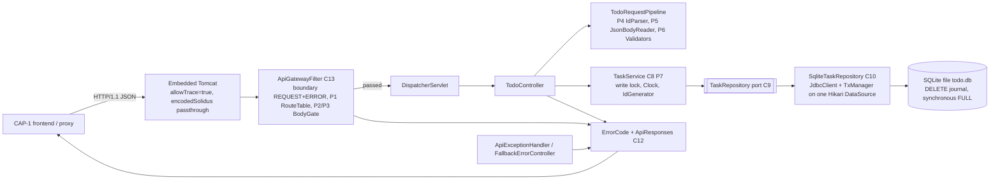
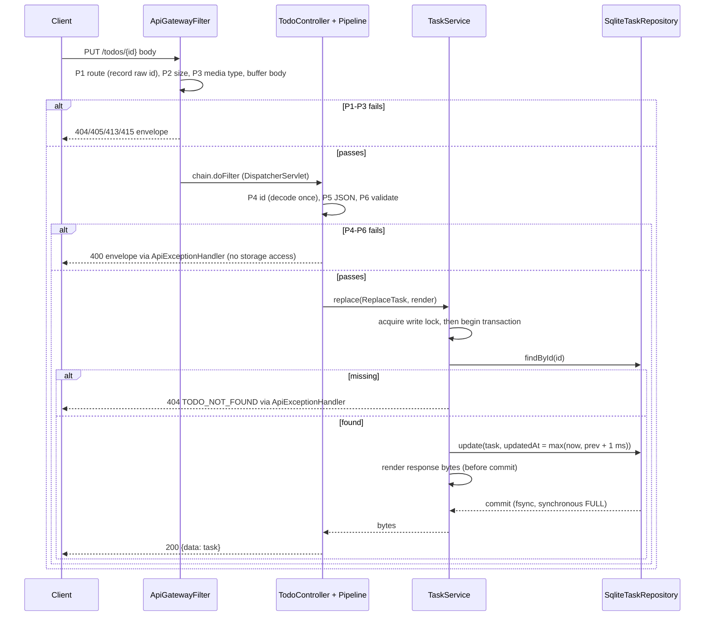

# Architecture - CAP-2: Todo App - Backend: Task management REST APIs

Status: REVISED (attempt 3; responses to design review round 1, findings DR-1..DR-15, are in section 16. The human
decided the stack, build tool, storage, location and the S2-4 edge cases in `clarifications.md` "Stage 2
clarifications". The version line, JDK target and the other items in section 14 are for ratification at G2.)
Inputs: requirements.md (approved at G1, `approvals.md` row G1), clarifications.md (Clar. #1-#22, S2-1..S2-4, S2-ENV),
design-review.md (round 1), open-issues.md, repo-profile.md

Note: the `requirements.md` header line still reads `Status: DRAFT`. `approvals.md` records `G1 | Approve`, and this
document treats the requirements as approved and final on that basis. S2-4 (human) refines the wording of FR-7, FR-13,
AC-15, AC-16 and A-16; section 13 cites it on those rows. Whether `requirements.md` gets an addendum is the
Orchestrator's decision (DR-14).

Evidence for technology statements: the human's decisions (S2-1 Java + Spring Boot, S2-1b Maven wrapper, S2-2 embedded
transactional single-file database, S2-3 `backend/`) and the toolchain the human reported (S2-ENV: Maven 3.10.1,
Oracle JDK 25.0.5.1, Windows 11 amd64; reported, not verified by any agent). The repository has no Java code, POM or
wrapper yet (repo-profile.md sections 1-3). Statements about Spring Boot, Spring Framework, Jackson, Tomcat, HikariCP,
SQLite, sqlite-jdbc, JUnit and Surefire behaviour come from those projects' public documentation as the architect
understands it, not from this repository. Every such statement the design depends on is **unverified** until the
named test proves it against the pinned versions; **section 14.1** lists each one with its proving test.
**No build or test command has been run. Every command in this document is PLANNED.**

## 1. Summary
CAP-2 is a new Java / Spring Boot (Spring MVC, embedded Tomcat) HTTP/JSON service in `backend/`, built with the Maven
wrapper. One ordered pipeline P1-P7 decides error precedence (FR-12):
- An `ApiGatewayFilter` is the first servlet filter. It is the error boundary for both the REQUEST and the ERROR
  dispatch, and on REQUEST it runs P1 (exact route table on the raw URI, 404/405, including TRACE, which Tomcat is
  configured to pass through), P2 (65,536-byte body cap, 413) and P3 (media type, 415). It buffers the raw body and
  records the raw id segment.
- Only requests that pass reach the `DispatcherServlet`. There a thin `TodoController` calls a `TodoRequestPipeline`:
  P4 id (decoded exactly once from the raw segment), P5 strict JSON read with a dedicated Jackson mapper, P6
  hand-written validation.
- The `TaskService` (P7 TODO_NOT_FOUND) serializes writes and persists through a `TaskRepository` port. The response
  bytes are rendered before the commit.
- The repository is implemented on **SQLite** (xerial `sqlite-jdbc`, Spring JDBC, one Hikari DataSource with one
  connection and one transaction manager). It uses `journal_mode=DELETE` and `synchronous=FULL`, so every acknowledged
  write has been fsynced to one database file. TRUNCATE, then WAL + FULL, are configuration-only fallbacks.

Spring and Tomcat defaults that would break precedence or the envelope are switched off or bypassed. These are
TRACE handling at the connector, auto HEAD/OPTIONS, `@RequestBody` conversion, `@PathVariable` decoding, content
negotiation (406), Boot's `/error` JSON, ProblemDetail, the form and character-encoding filters (section 7.5). One
error catalog produces every response body.

## 2. Architecture drivers
| Rank | Requirement ids | Why it drives the design |
|---|---|---|
| 1 | FR-12, AC-25, FR-11, FR-13, AC-16, AC-24, AC-12 | Strict precedence across 8 error classes, every one in the envelope. Spring MVC's own ordering would decide them differently: handler mapping produces 404/405/415, argument resolution produces 400s, auto HEAD/OPTIONS intervene, and Tomcat answers TRACE itself (unverified). The checks must therefore run in an order the service controls (D-1, D-12). |
| 2 | FR-10, NFR-4, AC-22, NFR-3 | Durable commit before acknowledgement. A rejected request changes nothing. Storage is an embedded single-file DB (S2-2); D-5 and D-6 choose the product and its settings. |
| 3 | FR-7, AC-20, AC-23, AC-28, AC-30, FR-8, AC-18 | Exact validation semantics: code-point length, Unicode White_Space trim, no coercion, all failures together, unknown fields ignored. Bean Validation and Jackson data-binding defaults would not give these (D-10, D-11). |
| 4 | FR-9, NFR-2, AC-12, AC-19, NFR-1, AC-13 | One envelope for every response, including container- and framework-level errors and 500s (D-15, D-19). |
| 5 | FR-2, AC-26, AC-27, FR-4, FR-6 | Deterministic ordering with a tie-break, and strictly increasing `updatedAt` (D-8, D-9). |
| 6 | NFR-6 (A-12), NFR-5, AC-35 | A body limit that never rejects a valid task, and p95 of 500 ms or less with an fsync on every write (D-2, D-6). |
| 7 | NFR-9, AC-34, NFR-10, AC-33, NFR-7, AC-36 | Negative requirements: no CORS, no escaping, no content in logs. Each needs an explicit test because frameworks can add these features. |

## 3. Existing system analysis
- Relevant modules/layers and their paths: none for the product. The repository holds only the SDLC framework
  (`docs/framework/README.md:30-41`; repo-profile.md section 1). `backend/` does not exist yet. There is no
  `pom.xml`, `mvnw`, `.mvn/` or `*.java` anywhere (Glob re-run in attempt 3; repo-profile.md section 2).
- Patterns and conventions to follow (evidence paths): stage artifacts live in `docs/sdlc/CAP-2/` (`CLAUDE.md`,
  "State and artifacts"). `.sdlc/` is gitignored (`.gitignore:1-2`). The application goes in `backend/` (S2-3).
  Maven's standard directory layout is used there (S2-1b; Maven convention, not repo evidence).
- Reusable code (paths): none.
- Constraints from the repo:
  - No CI (repo-profile.md section 5). S7 can run only the planned Maven commands, and only after they exist in
    `backend/` with provenance and the human allows them.
  - The shell allow list contains read-only git only (`.claude/settings.json:44-48`). Maven, and network access to
    Maven Central for the wrapper and dependencies, need human permission before S5 and S7 (S2-1b, G2-7: **not given**).
  - The current branch `Main` matches the protected `main` glob (`.claude/hooks/protected-branches.txt`). The repo has
    no commits (`git log`: "your current branch 'Main' does not have any commits yet"). Source edits in S5 need a
    non-protected branch (`.claude/hooks/agent-paths.conf:9,15`).
  - Host: Windows 11 amd64, agent shell Git Bash (session environment; S2-ENV). This affects the wrapper invocation
    (`./mvnw` in Git Bash, `mvnw.cmd` in cmd/PowerShell), file locking and deletion, fsync (`FlushFileBuffers`) and
    native-library loading (D-5, R-10, section 10 Testability).
  - Toolchain reported by the human (S2-ENV, not verified by any agent): Apache Maven 3.10.1, Oracle JDK 25.0.5.1,
    default locale `en_IN`, platform encoding UTF-8, time zone Asia/Calcutta. The design does not depend on the
    locale, platform encoding or time zone (D-9, D-11, D-13 use explicit UTF-8, UTC and `Locale.ROOT`).

## 4. Technology choices
| Concern | Choice | Evidence / justification | New to the repo? |
|---|---|---|---|
| Language / runtime | **Java**. Recommended: compile with **`--release 21`** on the installed JDK 25; tests run on JDK 25 | S2-1 (human); JDK 25.0.5.1 installed per S2-ENV (unverified). Target: section 4.1, **G2-2 to ratify**. | yes |
| Application framework | **Spring Boot** with Spring MVC on embedded Tomcat (servlet stack). Recommended line: section 4.1 | S2-1 (human). Servlet stack, because the design relies on servlet filters (D-1). **G2-2 to ratify the minor line.** | yes |
| Build tool | **Maven via the Maven wrapper** (`backend/mvnw`, `backend/mvnw.cmd`, `backend/.mvn/wrapper/maven-wrapper.properties`), parent `spring-boot-starter-parent`, `spring-boot-maven-plugin`; Surefire for unit/contract tests, Failsafe for the child-JVM durability test (both plugin versions managed by the Boot parent, unverified) | S2-1b (human). Maven 3.10.1 installed per S2-ENV. Wrapper bootstrap: G2-8. | yes |
| JSON | Jackson (brought in by the web starter; Jackson 3 in Boot 4.x, unverified), used **only through a dedicated, explicitly configured mapper** for parsing (tree model) and writing (D-14, D-15) | Boot's web starter ships Jackson. The dedicated mapper isolates the contract from `spring.jackson.*` and from version defaults. | yes |
| Validation | Hand-written validators. **Not** Bean Validation (`spring-boot-starter-validation` is not added) | D-10 | yes |
| Durable storage | **SQLite** single-file database through **xerial `sqlite-jdbc`**, accessed with Spring JDBC (`JdbcClient`, `DataSourceTransactionManager`, `TransactionTemplate`; `spring-boot-starter-jdbc`, one HikariCP DataSource with one connection) | S2-2 (human: embedded transactional single-file DB). Product choice: D-5. Wiring: D-22 | yes, new dependency (G2-1) |
| UUID generation | `java.util.UUID.randomUUID()` (SecureRandom-backed v4), emitted lowercase | Clar. #3 | yes |
| Logging | SLF4J + Logback (Spring Boot default) to the console; MDC request id | NFR-7; Boot default logging | yes |
| Test framework | `spring-boot-starter-test`: JUnit Jupiter, AssertJ, Spring Test, Boot test support (`@SpringBootTest`, output capture). JDK `java.net.http.HttpClient` and a small raw-socket helper for HTTP contract tests. Hand-written fakes are preferred over Mockito (section 14.1 item V-27) | S2-1: "JUnit-based tests assumed as the Spring Boot default". **Stated assumption A-ARCH-1:** the standard Boot test starter provides JUnit Jupiter; the JUnit generation in the pinned Boot BOM is checked at S4 (14.1 V-25). | yes |
| Performance measurement | JUnit test tagged `performance`, using the JDK HTTP client and computing p95 and max itself. No extra tool. | AC-35; avoids a new tool | yes |
| Not used (deliberately) | Spring Security, Actuator, DevTools, JPA/Hibernate, Bean Validation, Flyway/Liquibase, springdoc, ArchUnit | Each either changes responses (401/403, extra endpoints, ProblemDetail), adds a dependency for one check, or is unneeded for one table | - |

### 4.1 Version recommendation (flagged for G2 ratification, G2-2)
| Item | Recommendation | Reason | Alternatives |
|---|---|---|---|
| JDK target and build JDK | **Option A (recommended): compile with `--release 21` on the installed JDK 25** (`java.version=21` in the POM, which the Boot parent maps to the compiler release, unverified). Build and all tests run on JDK 25. | The design needs no feature newer than Java 17. `--release 21` makes javac check against the Java 21 API, so the artifact can also run on any JDK 21+ host. Cost: zero, because the only installed JDK is 25 and `--release` cross-compilation needs no second JDK. **Limit:** nothing will run on a JDK 21 runtime in S7, so "runs on 21" stays unverified; the verified runtime is JDK 25 only. | **B: `--release 25`** - build target equals the only tested runtime, so no untested gap, but deployment then needs JDK 25+; no feature in it is needed. **C: `--release 17`** - broadest reach (Boot 4.x baseline, unverified); same untested gap as A, no benefit here. |
| Spring Boot | **Pin one 4.x minor line at G2; the patch may float within that line and is written as an exact version in the POM at S4.** Selection rule: the newest 4.x minor that (1) has had at least one patch release after its `.0`, (2) has open-source support for at least 6 more months on the S4 date, and (3) lists Java 25 as supported. Candidate, **unverified**: **4.1.x**. The architect understands 4.0 went GA in November 2025 and that Boot ships a minor line about every six months, so 4.1 is expected from about May 2026 and 4.0's open-source support may be near its end on 2026-11-20. None of this is verified. The human (or the planner, reading the Spring Boot project page) confirms the line at G2. | New code should start on a supported 4.x line. Every override in section 7.5 is version-specific, so the line must be fixed before S4 writes code (DR-7). | 4.0.x if 4.1 is not GA or does not support JDK 25. A newer 4.x line (4.2, if GA) only after it has had a patch release. 3.5.x: Framework 6.2, Jackson 2; its support window must be checked at G2 (**unverified**; it may already have ended); choose it only for a team constraint. Sections 7.5 and 14.1 then need re-checking under 3.5 names. |
| sqlite-jdbc | Latest 3.x release at S4, pinned explicitly (not managed by the Boot BOM, unverified), with native libraries for Windows x86-64 | Bundles the SQLite engine | - |

What is unverified about JDK 25 (each item has a 14.1 row):
- Whether the pinned Boot 4.x line, Tomcat 11, HikariCP, sqlite-jdbc and the test libraries officially support JDK 25 (V-26).
- JDK 24+ restricts JNI (JEP 472, as the architect understands it): loading the sqlite-jdbc native library prints
  a warning unless native access is enabled. Plan: pass `--enable-native-access=ALL-UNNAMED` to the Surefire/Failsafe
  JVMs, the child JVM, `spring-boot:run`, and the run instructions in 10.2. If the flag or the executable-JAR manifest
  attribute behaves differently, the warning is accepted and documented, because it is a warning and does not stop the service (V-26).
- Warnings from libraries that use `sun.misc.Unsafe` memory-access methods, and from Mockito's dynamic agent if
  Mockito is used (V-27). These are warnings, not failures. Tests must not assert an empty stderr.

**Not confirmed:** whether `JAVA_HOME` points at JDK 25 for the agents' shell, and permission to run `./mvnw` and reach
Maven Central (G2-7, still not given). S2-ENV is the human's report; the planner's first S5 step, once permitted, is
`./mvnw -v`, and its output is recorded.

## 5. Decisions
| ID | Decision | Options considered | Choice and reason | Trade-offs |
|---|---|---|---|---|
| D-1 | Where precedence P1-P7 is enforced in Spring MVC | (a) Spring defaults: `@RequestMapping` + `consumes` + `@RequestBody @Valid` + `@ControllerAdvice`; (b) `HandlerInterceptor` for P2/P3 after Spring's handler mapping; (c) **`ApiGatewayFilter` (first servlet filter) for P1-P3 plus boundary, then a controller-invoked `TodoRequestPipeline` for P4-P6, then the service for P7** | (c). (a) lets Spring order the errors itself: 415 comes from mapping, 400 from type conversion, `@RequestBody` with no Content-Type gives 415 (contradicting A-11), and HEAD/OPTIONS are automatic. (b) still has Spring's mapping deciding 404/405, auto OPTIONS and implicit HEAD, and fixing those needs a subclassed handler mapping. In (c), the filter sees every request that reaches the servlet container's filter chain. That is every method token, **provided** the Tomcat connector is set to pass TRACE through (D-12, section 7.5; unverified until T-P1b passes). It is first in the chain because Boot's character-encoding filter is disabled and the order is asserted by T-RT (no reliance on order ties). The order is written once (section 7.2). | The route paths exist as annotation values and in `RouteTable`. Both use the same `ApiRoutes` constants (DR-13), and T-RT compares the API mappings (section 10.1). |
| D-2 | Body size limit (resolves A-12) | 8 KiB; 16 KiB; **64 KiB**; 1 MiB | **65,536 bytes** as received (after chunked decoding; no content-coding). 65,536 is accepted; 65,537 gives 413. The worst-case valid task is under 7,500 bytes: a 29-byte skeleton, plus 600 code points each sent as a 12-byte surrogate-pair escape (7,200), plus echoed server fields (about 145) and whitespace. That leaves more than 8x headroom. | Very heavily whitespace-padded bodies over 64 KiB are rejected even though they would trim to a valid task. This is acceptable under NFR-6. |
| D-3 | Applying the limit | full read, then check; **Content-Length first, then a counted read** | In the filter: Content-Length > 65,536 gives 413 without reading. Otherwise the body is read with a hard cap of 65,537 bytes, and reaching the cap gives 413. Applies to POST, PUT and PATCH only; GET and DELETE bodies are never read (A-8). Tomcat's `maxSwallowSize` drains or closes the unread remainder (unverified, V-5). With `Expect: 100-continue` and an oversized Content-Length, the 413 is written without reading the body; whether Tomcat has already sent `100 Continue` is recorded, not asserted (V-8, T-P2). | The connection may close after a 413; a client sending far more than the swallow limit may see a reset instead of the 413 (accepted). |
| D-4 | "Body present" and media-type test (A-11; S2-4 accepted) | header-based; **byte-based** | The body is present when Content-Length > 0 or the counted read yields at least 1 byte. With no body, P3 is skipped, and P5 then gives INVALID_REQUEST_BODY. Content-Type is parsed with Spring `MediaType.parseMediaType`. A parse failure, a missing header, more than one Content-Type header, or type/subtype other than `application/json` (case-insensitive) gives 415. `application/*+json` variants give 415. All parameters, including charset, are ignored, and the body is always decoded as UTF-8 (S2-4). | A body labelled with another charset is still read as UTF-8, so invalid bytes give INVALID_REQUEST_BODY. |
| D-5 | Embedded single-file DB product and Spring integration (S2-2) | **SQLite via xerial sqlite-jdbc + Spring JDBC**; H2 in file mode (MVStore) + Spring JDBC; HSQLDB file mode | **SQLite.** Durability on commit and restart: with `synchronous=FULL` the commit returns only after the journal and database are fsynced (`FlushFileBuffers` on Windows), and a crash or power loss rolls back to the last commit using the hot journal. H2's own documentation (as the architect understands it, unverified) says it does not guarantee that committed transactions survive a power failure, and MVStore writes with a delay by default, so it would need tuning and still offer a weaker guarantee. Concurrency: SQLite allows one writer at a time, which matches D-7. Licence and maintenance: the SQLite engine is public domain, actively maintained, and its file format is stable and backward compatible. sqlite-jdbc is Apache-2.0 and actively released. H2 is MPL-2.0/EPL-1.0 and maintained, but its file format changed incompatibly between 1.4 and 2.x (export/import needed), which is a risk for durable data. Windows: sqlite-jdbc ships Windows native libraries and extracts them to a temp directory at startup (R-10). H2 is pure Java, which is H2's main advantage. HSQLDB was not preferred: smaller community, and durability depends on its `WRITE_DELAY` setting. Spring integration: D-22. JPA is not used, so no SQLite Hibernate dialect is needed. | One native component (JNI; JDK 25 warning, section 4.1), and the version is not managed by the Boot BOM (pinned manually). Fallback: H2 behind the same port C9 (R-10). |
| D-6 | Durability settings | WAL + NORMAL; WAL + FULL; TRUNCATE + FULL; **rollback journal (`journal_mode=DELETE`) + `synchronous=FULL`** | DELETE + FULL are SQLite's defaults and its most conservative mode. At rest only the single `.db` file exists, which matches "single-file". Every commit fsyncs before returning. These are set per connection through `org.sqlite.SQLiteConfig` on the `SQLiteDataSource`, so every connection gets them. `busy_timeout=5000`. The journal mode is a property, `todo.store.journal-mode` (allowed values `DELETE`, `TRUNCATE`, `WAL`; default `DELETE`); `synchronous` is always `FULL` and is not configurable. At startup, `PRAGMA journal_mode` and `PRAGMA synchronous` are read back, logged once at INFO, and startup fails if they differ from the configured values. A response is sent only after the commit returns. **Fallback order** (configuration only, decided at S7 if R-10's journal-deletion problem appears, and recorded in the S7 report): (1) `TRUNCATE` + FULL: the journal is truncated instead of deleted, so no per-commit file deletion; a zero-length `todo.db-journal` stays beside the database at rest; durability equivalent to DELETE + FULL (unverified, V-29). (2) `WAL` + FULL: sidecar `-wal`/`-shm` files while running. | About 2-3 fsyncs per write, typically milliseconds to tens of milliseconds on Windows SSDs, well within NFR-5. The fallbacks weaken "single file at rest" slightly; G2-1. |
| D-7 | Concurrency (Clar. #18 last write wins) | optimistic locking; DB locking only; **one app-level write lock, taken before the transaction** | `TaskService` holds a fair `ReentrantLock` around each mutation. Inside it, a `TransactionTemplate` (not `@Transactional`) runs load, compute, save and render (D-23). The lock is always acquired **before** a connection is taken, which prevents deadlock with the 1-connection pool. All repository calls inside the transaction reuse the transaction-bound connection because `JdbcClient` and the transaction manager share the one DataSource (D-22). Reads take only a connection (no lock). The result is strictly increasing `updatedAt` and last-processed-wins. Supports one instance only. | Writes are serialized, which is fine for a single user. A read waits for the connection while a write holds it (milliseconds; bounded by `connectionTimeout` 5 s). A second instance on the same file is unsupported (R-6). |
| D-8 | Ordering and tie-break | createdAt only; **`ORDER BY created_at DESC, seq DESC`** | `seq INTEGER PRIMARY KEY AUTOINCREMENT`. SQLite AUTOINCREMENT never reuses values, even after deletes and restarts (documented SQLite behaviour, V-29). `seq` is never exposed and never updated. | none material |
| D-9 | Timestamps | `Instant.toString()`; `DateTimeFormatter.ISO_INSTANT`; **explicit formatter** | An injected `java.time.Clock` (UTC) supplies the time, truncated to milliseconds. createdAt = now. On PUT/PATCH, updatedAt = max(now, previous + 1 ms). Values are stored as INTEGER epoch milliseconds and formatted with the pattern `uuuu-MM-dd'T'HH:mm:ss.SSS'Z'` with `Locale.ROOT` and `ZoneOffset.UTC`, so the host locale (`en_IN`) and time zone (Asia/Calcutta) have no effect. `ISO_INSTANT` and `Instant.toString()` omit the fraction when it is zero, which would break AC-27. | updatedAt can run ahead of the wall clock in bursts. |
| D-10 | Validation implementation | Bean Validation on DTOs; Jackson data binding with coercion config; **hand-written checks on the Jackson tree** | Validators inspect `JsonNode` types directly. A number, boolean, array or object where a string is expected is a type error, so no coercion can occur regardless of Jackson's coercion defaults. Unknown members are never looked at (FR-8). Fields are checked in the order title, description, status, and every failure is collected (AC-20). | A little more code, fully unit-tested. |
| D-11 | Text decoding, trimming, counting (S2-4 accepted) | `String.strip()`/`trim()`; **explicit Unicode White_Space set + `codePointCount` + strict decoding** | The body bytes are decoded with a UTF-8 `CharsetDecoder` set to `CodingErrorAction.REPORT`, which rejects malformed, overlong and encoded-surrogate bytes. The platform default charset is never used. After parsing, every string value and member name in the whole document is scanned, and an unpaired surrogate gives INVALID_REQUEST_BODY (P5, S2-4). Trim removes the 25 White_Space code points: U+0009-000D, U+0020, U+0085, U+00A0, U+1680, U+2000-200A, U+2028, U+2029, U+202F, U+205F, U+3000. `String.strip()` uses `Character.isWhitespace`, which misses U+00A0, U+2007 and U+202F and includes U+001C-001F, so it must not be used. Length is `codePointCount`. | An unpaired surrogate inside an *ignored* member also gives INVALID_REQUEST_BODY. This is a body-level malformation like a syntax error, consistent with S2-4 "in JSON"; FR-8 covers well-formed members. Ratified under G2-5. |
| D-12 | Routing (S2-4 accepted; A-15, A-16) | Spring handler mapping; **own `RouteTable` in the filter, matched on the raw request URI** | The match uses `HttpServletRequest.getRequestURI()`, which is raw, undecoded and excludes the query string (unverified for Tomcat 11, V-4), so the query is ignored (S2-4). The context path is empty. Paths match exactly, segment by segment, against the `ApiRoutes` templates `/todos`, `/todos/{id}`, `/todos/{id}/status`. Literal segments are compared raw, so a percent-encoded literal (`/%74odos`) means no match. An empty segment, a trailing slash, `//`, or a `;param` suffix means no match (404 NOT_FOUND). The id segment is kept raw and recorded in a `RouteMatch` request attribute (D-13). A defined path with any other method token (HEAD, OPTIONS, **TRACE**, lowercase `get`, unknown tokens) gives 405 METHOD_NOT_ALLOWED with the route's `Allow` header (`GET, POST` / `GET, PUT, DELETE` / `PATCH`). Any method on an undefined path gives 404. **TRACE:** Tomcat's connector has `allowTrace=false` by default and then answers TRACE itself before the filter chain, with its own `Allow` list and no envelope (unverified, V-1). `TomcatConfig` therefore sets `allowTrace=true` so that TRACE reaches C13, which always rejects it at P1. TRACE never reaches the DispatcherServlet, so `HttpServlet.doTrace` never echoes headers. **HEAD:** responses carry the status and headers but no body; C13 writes no body for HEAD itself, so this does not depend on Tomcat suppressing it. A Tomcat connector customizer sets `encodedSolidusHandling=passthrough` so that `%2F` in an id reaches the app and gives INVALID_ID instead of a container 400 (V-2). | A request that is not valid HTTP, or a URI Tomcat rejects (for example an invalid `%` sequence), is still answered by Tomcat outside the envelope (R-12, G2-6). If `allowTrace=true` cannot be set or does not route TRACE to the filter in the pinned Tomcat, TRACE moves to G2-6 (fallback, R-1). |
| D-13 | Id parsing (S2-4 accepted; one id source, DR-2) | `UUID.fromString` alone; lowercase only; Spring `@PathVariable`; **raw segment from C3, decoded once by C5, strict regex, case-insensitive, normalised to lowercase** | The only input is the raw id segment that C3 stored in the `RouteMatch` attribute. Controllers declare no `@PathVariable`; the `{id}` in the mapping exists only so that Spring dispatches the request. C5 percent-decodes the raw segment **exactly once**, strictly: `%` must be followed by two hex digits, the decoded bytes must be valid UTF-8, and `+` is literal. Any failure gives INVALID_ID. The result must match `^[0-9a-fA-F]{8}-[0-9a-fA-F]{4}-[0-9a-fA-F]{4}-[0-9a-fA-F]{4}-[0-9a-fA-F]{12}$`, or INVALID_ID results. It is then lowercased with `Locale.ROOT`. So `%61` decodes to `a` and, in a valid UUID position, is accepted. `%2530` decodes once to `%30`, which fails the regex, so it is never decoded twice. `UUID.fromString` alone is lenient (it accepts forms such as `1-1-1-1-1`), so it must not be the check. Any version or variant is accepted because ids are opaque. | An uppercase or percent-encoded-hex spelling finds the same task (G2-5 (f)). |
| D-14 | JSON strictness details | Boot's shared `ObjectMapper`; Jackson version defaults; **dedicated `apiJsonMapper` bean with every relevant read feature set explicitly** | C6 first rejects a decoded text that starts with U+FEFF (explicit check, so it does not depend on Jackson's handling of a BOM in character input). Parsing then uses a parser over the decoded text: `readTree`, then the parser must return no further token, so trailing tokens give INVALID_REQUEST_BODY. `FAIL_ON_TRAILING_TOKENS` is also set on explicitly. Every relevant read feature is set explicitly, on or off, never left to the version default: duplicate detection (`STRICT_DUPLICATE_DETECTION`) **off** and tree duplicate-key failure (`FAIL_ON_READING_DUP_TREE_KEY`) **off**, so **duplicate keys resolve last-occurrence-wins**; comments (Java and YAML style), single quotes, unquoted names, trailing commas, missing values, non-numeric numbers (NaN, Infinity), leading zeros, leading plus sign, leading/trailing decimal point, unescaped control characters, and backslash-escaping of any character all **off**. `StreamReadConstraints` are set explicitly: maximum nesting depth 1,000, maximum number length 1,000 characters, maximum string length 65,536 (the body cap, so it never triggers before P2) (G2-5 (b)). Exceeding a constraint gives INVALID_REQUEST_BODY. Every Jackson read exception maps to INVALID_REQUEST_BODY and is not logged. A missing, empty or whitespace-only document, or a non-object root, gives INVALID_REQUEST_BODY (AC-3, AC-23). Feature and class names differ between Jackson 2 and 3 (unverified, V-22); the planner uses the names of the pinned version, and U-JSON proves each behaviour. | Boot's `spring.jackson.*` properties do not affect the API mapper. This is intended. A number longer than 1,000 characters or nesting deeper than 1,000 inside an ignored member gives 400 (G2-5 (b)). |
| D-15 | Response writing and headers | `@ResponseBody` objects with Spring's Jackson converter and content negotiation; **C12 serializes envelopes to bytes; controllers return `ResponseEntity<byte[]>` with explicit `Content-Type: application/json`** | One serializer (`apiJsonMapper`) produces both filter-written and controller-written bodies. Because the content type is preset and Accept is ignored (`ContentNegotiationConfigurer.ignoreAcceptHeader(true)`, V-12), Spring never returns 406, which is not in the catalog. `X-Content-Type-Options: nosniff` is set by the filter on every response, in both the REQUEST and ERROR dispatch, and again by FallbackErrorController. No `Access-Control-*` headers: no `@CrossOrigin`, no CORS mappings, and OPTIONS is rejected at P1. Jackson does not HTML-escape and does not escape non-ASCII (NFR-10; set explicitly, V-23). 204 has no body and no Content-Type. | The JSON content type carries no charset parameter (RFC 8259 defines none; the body is always UTF-8). The character-encoding filter is disabled so that it cannot add one (D-1, V-9). |
| D-16 | Network exposure | all interfaces; **`server.address=127.0.0.1` by default, configurable** | No authentication (out of scope), so the safe default limits exposure. | The CAP-1 proxy must reach loopback or a configured address. |
| D-17 | Code location and layout (S2-3) | repo root; **`backend/` as one Maven module** | Keeps framework `docs/`, `scripts/`, `tests/` separate. `backend/.gitignore` holds the build and data ignores, so the root `.gitignore` is untouched. | none |
| D-18 | Java coordinates and base package | **G2 to ratify:** groupId `com.capstone`, artifactId `todo-backend`, package `com.capstone.todo` | There is no organisational convention in the repo, so this is a placeholder default. | Renaming later is mechanical. |
| D-19 | Overriding Spring's error handling | Boot `BasicErrorController` + whitelabel; `ResponseEntityExceptionHandler` / ProblemDetail; **own advice + own `ErrorController` + boundary in the filter for REQUEST and ERROR dispatch** | `ApiExceptionHandler` (`@RestControllerAdvice`, **not** extending `ResponseEntityExceptionHandler`) maps `ApiException` to its code, `TaskNotFoundException` to TODO_NOT_FOUND, Spring's `NoHandlerFoundException`/`NoResourceFoundException` to NOT_FOUND, `HttpRequestMethodNotSupportedException` to METHOD_NOT_ALLOWED and `HttpMediaTypeNotSupportedException` to UNSUPPORTED_MEDIA_TYPE (the last three should never happen; they are a safety net, R-16), and `Exception` to INTERNAL_ERROR. A `FallbackErrorController implements ErrorController` at `/error` (all methods; reachable only through container ERROR dispatch, because P1 rejects `/error` as a REQUEST) replaces `BasicErrorController` (Boot backs off when an `ErrorController` bean exists, V-18). It maps the container status to the envelope (404 to NOT_FOUND, 405, 413, 415, anything else to INTERNAL_ERROR), never echoes attributes, sets `nosniff` itself, and writes fixed bytes prepared at startup by C12 so that it has no failure path of its own. **ERROR dispatch:** C13 is registered for dispatcher types REQUEST **and** ERROR. On an ERROR dispatch it runs in **boundary-only mode**: no P1-P3; it restores the MDC request id from a request attribute set during the REQUEST dispatch (or creates one), sets `nosniff`, and wraps the chain in the same try/catch (`OncePerRequestFilter.shouldNotFilterErrorDispatch()` overridden to return false, V-10). `server.error.include-stacktrace=never`, `include-message=never`, `whitelabel.enabled=false`, `spring.mvc.problemdetails.enabled=false`. Tomcat's `ErrorReportValve` is set to `showReport=false`, `showServerInfo=false`. | Container-level rejections before the app (malformed request line, oversized headers, URIs Tomcat rejects) cannot use the envelope (R-12, G2-6). |
| D-20 | Logging (one rule, DR-5) | Boot structured logging; boundary-only logging; **default Logback console format, MDC request id, each unexpected failure logged exactly once, by the component that converts it to 500** | C13 puts a request id (UUID) into the MDC. **Rule:** (1) `ApiExceptionHandler` logs at ERROR every exception it converts to INTERNAL_ERROR (service, store and controller failures). It does not log the 4xx it maps. (2) C13 logs at ERROR only a `Throwable` that escapes `chain.doFilter` (a failure in the filter itself, in the DispatcherServlet outside handler invocation, in the advice, or in the error controller during ERROR dispatch); these were never handled, so they were never logged. (3) `FallbackErrorController` logs at ERROR each 500 it writes, with the class of the `jakarta.servlet.error.exception` attribute if present. Client-abort I/O errors are logged at DEBUG only. A failure inside a failure handler produces one entry per distinct exception, never two entries for the same exception. Each entry has: timestamp, level, request id, method, route template (for example `/todos/{id}`, never the raw URI), exception class and stack trace. At startup, one INFO line each gives the absolute data-file path and the journal mode. Nothing else is logged per request. The Tomcat access log stays disabled (Boot default) because it would record query strings. | Stack traces span several lines. A structured format can be enabled later without code changes. |
| D-21 | Test approach | MockMvc only; **unit + real-server contract tests + child-JVM durability + tagged performance** | Precedence depends on Tomcat (raw URI, chunked bodies, HEAD, TRACE, `%2F`, ERROR dispatch) and on filter order, which MockMvc bypasses. Contract tests therefore run `@SpringBootTest(webEnvironment = RANDOM_PORT)` against real Tomcat. Test data lifecycle is Windows-safe (section 10, Testability). | Slower than MockMvc, still seconds. |
| D-22 | Persistence wiring (DR-6) | Boot DataSource auto-configuration with `spring.datasource.*`; two DataSources (read/write); **one DataSource, one transaction manager, all built in code** | `PersistenceConfig` defines exactly one `DataSource` bean: a `HikariDataSource` built from a `HikariConfig` in code, wrapping the `SQLiteDataSource` (`SQLiteConfig`: journal mode, `synchronous=FULL`, busy timeout), with `maximumPoolSize=1`, `minimumIdle=1` and an explicit `connectionTimeout` of 5,000 ms (Hikari's default is 30 s, unverified, V-21). It defines exactly one `DataSourceTransactionManager` on that bean, and builds the `TransactionTemplate` and the `JdbcClient` from those two beans. Spring's connection binding (`DataSourceUtils`) makes every `JdbcClient` call inside a `TransactionTemplate` callback reuse the transaction's connection (unverified, V-20). Boot's DataSource and transaction-manager auto-configuration back off because these beans exist (V-20). No `spring.datasource.*` or `spring.datasource.hikari.*` property is used; the pool size is set in code only. | A misconfiguration (a second DataSource or manager) would make a write wait 5 s for the only connection and then fail with 500, rather than hang; T-TX detects it. |
| D-23 | Response rendering relative to the commit (DR-12) | serialize after commit; **render inside the transaction, before commit; send after commit** | Mutating service methods take a render function (`Function<Task, R>`, a JDK type, so `domain` still imports nothing from `web`). The function runs inside the `TransactionTemplate` callback after the write statements and before the commit; the controller passes a C12 renderer that returns the response bytes. If rendering fails, the transaction rolls back and the response is 500 with nothing stored, so "500 means unchanged" holds for this case. The bytes are sent after the commit returns. | The only remaining gap is a commit that succeeds while the socket write fails (client gone); the client then sees a connection error, not a 500. |

## 6. Components and responsibilities
Base path `backend/src/main/java/com/capstone/todo/` (written as `.../`). Package names follow D-18. All components are new.

| Component | Responsibility | New / changed / reused | Path |
|---|---|---|---|
| C1 Bootstrap | `TodoApplication` (`@SpringBootApplication`). Startup fails with a non-zero exit if the store cannot be opened or verified (C10). | new | `.../TodoApplication.java` |
| C2 Config | `TodoProperties` (`@ConfigurationProperties("todo")`: `dataFile`, default `./data/todo.db`, resolved against the working directory to an absolute path and logged at startup, parent directories created; `store.journalMode`, default `DELETE`). `WebConfig`: registers C13 through `FilterRegistrationBean` (order `Ordered.HIGHEST_PRECEDENCE`, dispatcher types **REQUEST and ERROR**, URL pattern `/*`) and sets content negotiation to ignore Accept. `TomcatConfig`: connector customizer (`allowTrace=true`, `encodedSolidusHandling=passthrough`) and ErrorReportValve settings. `PersistenceConfig`: D-22 (one `HikariDataSource`, one `DataSourceTransactionManager`, `TransactionTemplate`, `JdbcClient`). `JsonConfig`: the `apiJsonMapper` bean (D-14). `application.properties`: section 7.5. | new | `.../config/*`, `backend/src/main/resources/application.properties` |
| C3 RouteTable | Exact route and method table built from `ApiRoutes`, `Allow` values, extraction of the raw id segment into a `RouteMatch(route, rawIdSegment)` request attribute. P1. | new | `.../web/gate/RouteTable.java`, `.../web/gate/RouteMatch.java` |
| ApiRoutes | String constants `TODOS="/todos"`, `TODO_ITEM="/todos/{id}"`, `TODO_STATUS="/todos/{id}/status"`, used by both C3 and the controller annotations (one literal source, DR-13) | new | `.../web/ApiRoutes.java` |
| C4 BodyGate | P2 size (D-2, D-3) and P3 media type (D-4) for POST/PUT/PATCH. Produces a `RawBody` (bytes, present flag) stored as a request attribute. | new | `.../web/gate/BodyGate.java` |
| C13 ApiGatewayFilter (error boundary) | `OncePerRequestFilter` and the outermost wrapper, for REQUEST and ERROR dispatch (D-19). REQUEST: sets the MDC request id (also stored as a request attribute) and `nosniff`, runs C3 then C4, writes P1-P3 errors through C12, and calls `chain.doFilter`. ERROR: boundary-only mode. Catches any `Throwable` that escapes. If the response is not committed it writes 500 INTERNAL_ERROR; it logs per D-20 rule (2). Client-abort I/O errors are not treated as failures. Clears the MDC in `finally`. | new | `.../web/gate/ApiGatewayFilter.java` |
| C5 IdParser | P4 (D-13): strict single percent-decode of the raw segment, regex, lowercase. Throws `ApiException(INVALID_ID)`. | new | `.../web/request/IdParser.java` |
| C6 JsonBodyReader | P5: strict UTF-8 decode, explicit BOM check, `readTree`, trailing-token, root-object and unpaired-surrogate checks (D-11, D-14). Throws `ApiException(INVALID_REQUEST_BODY)`. | new | `.../web/request/JsonBodyReader.java` |
| Request pipeline | `TodoRequestPipeline`: one method per operation (`create(raw)`, `replace(routeMatch, raw)`, `setStatus(routeMatch, raw)`, `id(routeMatch)`), each running P4, then P5, then P6 in that fixed order and returning a typed command. This is the single place where P4-P6 are ordered. | new | `.../web/request/TodoRequestPipeline.java` |
| C7 Validators | `TaskRequestValidator` (section 7.4 rules, all fields, CAP-1 wording) and `UnicodeText` (White_Space trim, code-point length). Produce `CreateTask`, `ReplaceTask`, `SetStatus`. | new | `.../validation/*` |
| Controller | `TodoController` (`@RestController`). Mappings are exactly the six operations, using `ApiRoutes` constants, **without** `consumes`/`produces` and **without** `@PathVariable` (the `{id}` template is for dispatch only). `RouteMatch` and `RawBody` come from request attributes through a small `HandlerMethodArgumentResolver`; `@RequestBody` is never used. Calls the pipeline, then C8 with a C12 render function (D-23), then returns `ResponseEntity<byte[]>`. | new | `.../web/TodoController.java`, `.../web/GateAttributeArgumentResolver.java` |
| Exception mapping | `ApiExceptionHandler` and `FallbackErrorController` (D-19), logging per D-20 rules (1) and (3) | new | `.../web/ApiExceptionHandler.java`, `.../web/FallbackErrorController.java` |
| C8 TaskService | Use cases create, list, get, replace, setStatus, delete. Write lock (D-7), timestamps (D-9), Pending default, render-before-commit (D-23). Throws `TaskNotFoundException` (domain), which is P7. Imports nothing from `web` or `persistence`; no `@Transactional` (U-ARCH). | new | `.../domain/TaskService.java`, `Task`, `TaskStatus`, commands, `TaskNotFoundException` |
| C9 TaskRepository port | `List<Task> findAllOrdered()`, `Optional<Task> findById(UUID)`, `insert(Task)`, `update(Task)`, `boolean delete(UUID)`. Each mutation is atomic and durable on return of the enclosing transaction. | new | `.../domain/TaskRepository.java` |
| C10 SqliteTaskRepository + SchemaInitializer | Parameterized SQL through `JdbcClient`. `SchemaInitializer` (runs at startup, before the web server accepts requests) checks `PRAGMA user_version`: 0 creates the schema and sets it to 1; 1 is OK; anything else fails startup. It reads back the pragmas against the configured values (D-6). Boot's `spring.sql.init` is not used. | new | `.../persistence/*` |
| C11 Clock and IdGenerator | `Clock` bean (`Clock.systemUTC()`) and an `IdGenerator` interface (default `UUID.randomUUID`). Tests replace both. | new | `.../domain/support/*`, bean in `.../config/` |
| C12 Error catalog and response writer | `ErrorCode` enum (code, HTTP status, default English message), `ApiException`, `ApiResponses` (builds `{data}`/`{error}` bytes with `apiJsonMapper`; `details` only for VALIDATION_ERROR; precomputed bytes for the fixed error bodies), `TaskJson` (field order id, title, description, status, createdAt, updatedAt; D-9 format). The only producer of response bodies. | new | `.../web/response/*` |
| C14 Tests | Section 10 (Testability) and 10.1 | new | `backend/src/test/java/com/capstone/todo/{unit-mirroring packages, contract, durability, performance, support}` |
| Build files | `backend/pom.xml`, `backend/mvnw`, `backend/mvnw.cmd`, `backend/.mvn/wrapper/maven-wrapper.properties`, `backend/.gitignore` (`target/`, `data/`) | new | `backend/` |

## 7. Interfaces and contracts
### 7.1 External HTTP interface (fixed by requirements Appendix A)
| Interface | Producer -> consumer | Inputs | Outputs | Errors and failure modes |
|---|---|---|---|---|
| POST /todos | service -> CAP-1 | JSON object `{title, description?}`; other members ignored | 201 `{data: Task}` | 413, 415, 400 INVALID_REQUEST_BODY, 400 VALIDATION_ERROR, 500 |
| GET /todos | service -> CAP-1 | none (body, Content-Type, Accept and query ignored) | 200 `{data: Task[]}` ordered per D-8, may be empty | 500 |
| GET /todos/{id} | service -> CAP-1 | id | 200 `{data: Task}` | 400 INVALID_ID, 404 TODO_NOT_FOUND, 500 |
| PUT /todos/{id} | service -> CAP-1 | id; JSON object `{title, description?}` | 200 `{data: Task}`; status and createdAt unchanged | 413, 415, INVALID_ID, INVALID_REQUEST_BODY, VALIDATION_ERROR, TODO_NOT_FOUND, 500 |
| DELETE /todos/{id} | service -> CAP-1 | id | 204, no body | INVALID_ID, TODO_NOT_FOUND (also on repeat, A-5), 500 |
| PATCH /todos/{id}/status | service -> CAP-1 | id; JSON object `{status}` | 200 `{data: Task}` | 413, 415, INVALID_ID, INVALID_REQUEST_BODY, VALIDATION_ERROR (field status), TODO_NOT_FOUND, 500 |
| any other path / method (incl. HEAD, OPTIONS, TRACE) | service -> any client | - | - | 404 NOT_FOUND on undefined paths (any method); 405 METHOD_NOT_ALLOWED with the route's `Allow` on defined paths. HEAD: status and headers, no body |

Task object: `{ id, title, description, status, createdAt, updatedAt }`. `description` is always present. `seq` is
never emitted. Error object: `{ error: { code, message, details? } }`, with `details` = `[{ field, message }]` on
VALIDATION_ERROR only.

### 7.2 Request pipeline and error precedence in Spring terms (FR-12, AC-25)
The first error wins and nothing after it runs. P1-P6 never touch storage, so a rejected request leaves data
unchanged (NFR-3).

| Stage | Spring element | Applies to | Check | Error (HTTP) |
|---|---|---|---|---|
| boundary | `ApiGatewayFilter` try/catch (C13), first servlet filter, REQUEST and ERROR dispatch | all | any unexpected `Throwable` from the filter, the DispatcherServlet, the advice, the error controller, the service or the store | INTERNAL_ERROR (500) |
| P1 | `ApiGatewayFilter` -> `RouteTable` (REQUEST dispatch only) | all, including TRACE (connector `allowTrace=true`) | raw URI matches exactly; otherwise the method is in the route's set | NOT_FOUND (404) / METHOD_NOT_ALLOWED (405) |
| P2 | `ApiGatewayFilter` -> `BodyGate` | POST, PUT, PATCH | Content-Length or counted bytes of at most 65,536 | PAYLOAD_TOO_LARGE (413) |
| P3 | `ApiGatewayFilter` -> `BodyGate` | POST, PUT, PATCH with a body present (D-4) | exactly one Content-Type header, media type `application/json` | UNSUPPORTED_MEDIA_TYPE (415) |
| - | `chain.doFilter` -> `DispatcherServlet` -> `TodoController` (mapping cannot fail: same `ApiRoutes` constants; R-16) | passed requests | - | - |
| P4 | `TodoRequestPipeline` -> `IdParser` on `RouteMatch.rawIdSegment` | routes with `{id}` | single strict decode, canonical UUID (D-13) | INVALID_ID (400), via `ApiExceptionHandler` |
| P5 | `TodoRequestPipeline` -> `JsonBodyReader` | POST, PUT, PATCH | non-empty, strict UTF-8, no BOM, valid JSON, single object root, no unpaired surrogates, within parser constraints | INVALID_REQUEST_BODY (400) |
| P6 | `TodoRequestPipeline` -> `TaskRequestValidator` | POST, PUT, PATCH | section 7.4; all failures collected | VALIDATION_ERROR (400) |
| P7 | `TaskService` (inside the write lock for PUT/PATCH/DELETE) | routes with `{id}` | task exists | TODO_NOT_FOUND (404), via `ApiExceptionHandler` |

Structural rules (checked in code review): no `@RequestBody`, `@PathVariable`, `@Valid`, `consumes`, `produces`,
`@CrossOrigin` or `@ResponseStatus` exceptions. Controllers do not read the input stream. Route literals appear only in
`ApiRoutes`. No other filter is ordered ahead of C13 (asserted by T-RT). `ResponseEntityExceptionHandler` is not
extended. C12 is the only producer of bodies. No `@Transactional` anywhere in `domain` (U-ARCH).

### 7.3 Internal interfaces
| Interface | Producer -> consumer | Inputs | Outputs | Errors and failure modes |
|---|---|---|---|---|
| TaskService | C8 -> TodoController | `CreateTask{title, description}`, `ReplaceTask{id, title, description}`, `SetStatus{id, status}`, `UUID`; for mutations a `Function<Task, R>` render function (D-23) | `R` (rendered bytes) / `Task` / `List<Task>` / void | `TaskNotFoundException` -> TODO_NOT_FOUND; `DataAccessException` or a render failure propagates -> 500, transaction rolled back |
| TaskRepository | C10 -> C8 | `Task` incl. seq | ordered list, optional task, deleted flag | `DataAccessException` (I/O, busy, corrupt, connection timeout); no partial writes (transaction rollback) |
| Clock / IdGenerator | C11 -> C8 | - | `Instant` (ms); `UUID` | none |
| Error catalog | C12 -> filter, advice, error controller | `ErrorCode` (+ details) | status + bytes | - |
| RouteMatch attribute | C3 -> GateAttributeArgumentResolver -> pipeline | request attribute | `RouteMatch(route, String rawIdSegment)` (raw, undecoded; null for `/todos`) | missing attribute is a programming error -> 500 |
| RawBody attribute | C4 -> GateAttributeArgumentResolver | request attribute | `RawBody(byte[] bytes, boolean present)` | missing attribute is a programming error -> 500 |

### 7.4 Validation rules (C7). One detail per failing field, in the order title, description, status
| Field | Rule (first failing rule per field reported) | Example message (not a contract, AC-20) |
|---|---|---|
| title (POST, PUT) | absent or JSON null -> required (A-13); not textual -> type; trimmed length 0 -> required; trimmed length > 100 code points -> too long | "Title is required"; "Title must be a string"; "Title must be 100 characters or fewer" |
| description (POST, PUT) | absent or JSON null -> ""; not textual -> type; trimmed length > 500 -> too long; whitespace-only -> "" | "Description must be a string"; "Description must be 500 characters or fewer" |
| status (PATCH) | absent or JSON null -> required; not textual, or not exactly `Pending`/`Completed` -> invalid | "Status is required"; "Status must be Pending or Completed" |
| any other member (incl. id, status on POST/PUT, createdAt, updatedAt) | ignored, never an error (FR-8), within the body-level limits of D-11 and D-14 (G2-5 (b)) | - |

### 7.5 Spring and Tomcat defaults overridden
Each row is verified by the named test (section 10.1). Every default listed is the architect's understanding and is
**unverified** until that test passes against the pinned versions (section 14.1 gives the V-item for each).

| Default behaviour | Why it would break the contract | Override | Test |
|---|---|---|---|
| **Tomcat connector `allowTrace=false`: Tomcat answers TRACE itself, before the filter chain, with 405, its own `Allow` list and no envelope, also on undefined paths (unverified, V-1)** | AC-12 envelope; AC-24/FR-11 404 on undefined paths; D-12 `Allow` values | `TomcatConfig` connector customizer sets `allowTrace=true`, so TRACE reaches C13, which always rejects it at P1 (405 with the route's `Allow` on defined paths, 404 NOT_FOUND on undefined paths). TRACE never reaches the DispatcherServlet, so it is never echoed. Fallback if unworkable: list TRACE under G2-6 | T-P1b |
| Implicit HEAD for GET mappings; automatic OPTIONS with `Allow` | A-16 / S2-4: HEAD and OPTIONS must give 405 | P1 in the filter rejects them before Spring sees them; C13 writes no body for HEAD | T-P1b |
| Handler-mapping 404 / 405 / 415 (`consumes`) | Spring's own order and format | P1/P3 in the filter; no `consumes`; advice safety net | T-P1a, T-P3, T-RT |
| `@RequestBody` with no Content-Type gives 415; `HttpMessageNotReadableException` | Breaks A-11 and P4-before-P5 | Raw body resolver; P5 hand-run | T-P4, T-P5 |
| `@PathVariable` decoding (Spring decodes the segment) and `UUID` conversion (`MethodArgumentTypeMismatchException`); lenient `UUID.fromString` | Double decoding (DR-2), wrong timing and leniency | No `@PathVariable`; raw segment from C3 decoded once by C5 + regex | T-P4, U-ID |
| Boot's `CharacterEncodingFilter` registered at `Ordered.HIGHEST_PRECEDENCE`, the same order as C13 (unverified, V-9) | An order tie makes "C13 first" unguaranteed; forcing a response charset would change `Content-Type` | Disabled (`server.servlet.encoding.enabled=false`, name unverified for 4.x); C13 reads bytes and writes bytes itself, so it needs no encoding filter. If it cannot be disabled, T-RT asserts the actual order and the reason it is safe is documented | T-RT, T-HDR |
| `OncePerRequestFilter` skips the ERROR dispatch; `FilterRegistrationBean` defaults to REQUEST only (unverified, V-10, V-11) | ERROR dispatch runs outside the boundary: no `nosniff`, no request id, failures uncaught | C13 registered for REQUEST and ERROR, `shouldNotFilterErrorDispatch()` returns false, boundary-only mode on ERROR | T-ERR, T-LOG |
| Content negotiation 406 on unsupported Accept | 406 is not in the catalog | `ignoreAcceptHeader(true)`; preset content type; `ResponseEntity<byte[]>` | T-ACC |
| Boot `BasicErrorController` JSON (`timestamp`, `status`, `path`) and whitelabel page | Wrong envelope; may leak a path or message | Own `ErrorController`; `server.error.*` never-include; whitelabel off | T-ERR |
| ProblemDetail (RFC 9457) responses | Wrong envelope | `spring.mvc.problemdetails.enabled=false`; advice does not extend `ResponseEntityExceptionHandler` | T-ERR |
| `FormContentFilter` consumes `application/x-www-form-urlencoded` bodies on PUT/PATCH/DELETE | Body consumed before P3 | C13 ordered first (it rejects form bodies with 415); also `spring.mvc.formcontent.filter.enabled=false` | T-P3, T-RT |
| Multipart resolution | Parses bodies outside the pipeline | `spring.servlet.multipart.enabled=false`; P3 rejects multipart anyway | T-P3 |
| Static resource handler on `/**` (`NoResourceFoundException`) | Unmatched paths would be handled as resource lookups | `spring.web.resources.add-mappings=false`; P1 first | T-P1a |
| Trailing-slash matching | A-15 | Off by default in Spring Framework 6+ (V-19); P1 exact match is authoritative | T-P1a |
| Tomcat rejects `%2F` with a container 400 | INVALID_ID expected | `encodedSolidusHandling=passthrough` (V-2) | T-P4 |
| Tomcat handling of `%5C` (encoded backslash) (default unverified, V-3) | INVALID_ID expected | If the default is a container 400, set `encodedReverseSolidusHandling=passthrough` when the pinned Tomcat has it; otherwise the case is listed under G2-6 | T-P4 |
| Tomcat `ErrorReportValve` HTML with server info | Leaks the version | `showReport=false`, `showServerInfo=false` | T-ERR |
| Boot DataSource and transaction-manager auto-configuration; `spring.datasource.hikari.*` binding; Hikari `connectionTimeout` 30 s (unverified, V-20, V-21) | A second DataSource or manager, or an unbound pool size, would break the lock-before-connection rule (D-7) | D-22: one DataSource and one manager built in code; pool size 1 and `connectionTimeout` 5 s set in code | T-TX, U-REPO |
| Jackson coercion, unknown-property failure, duplicate handling, trailing tokens, BOM handling, read constraints, Jackson 2 vs 3 defaults (V-22) | AC-20, FR-8, D-14 | Tree model + explicit `apiJsonMapper` with every read feature set + explicit BOM and trailing-token checks | U-JSON |
| `spring.jackson.*` customisation of the shared mapper | Could change output | API uses only `apiJsonMapper` | U-RESP |
| CORS processing | NFR-9 | No `@CrossOrigin`/`addCorsMappings`; OPTIONS 405 | T-CORS |
| Tomcat access log, request logging | Logs query strings / content | Kept disabled (defaults); no request-logging filter | T-LOG |
| Hidden HTTP method filter | Method override through a form field | Disabled by default (`spring.mvc.hiddenmethod.filter.enabled=false`, V-15); set explicitly | T-RT |

Planned `application.properties` keys: `server.address=127.0.0.1`, `server.port=8080` (Boot default, configurable),
`todo.data-file=./data/todo.db`, `todo.store.journal-mode=DELETE`, `server.error.include-stacktrace=never`,
`server.error.include-message=never`, `server.error.whitelabel.enabled=false`, `spring.mvc.problemdetails.enabled=false`,
`spring.mvc.formcontent.filter.enabled=false`, `spring.mvc.hiddenmethod.filter.enabled=false`,
`spring.servlet.multipart.enabled=false`, `spring.web.resources.add-mappings=false`,
`server.servlet.encoding.enabled=false`. No `spring.datasource.*` keys (D-22). No secrets exist. All property names
are checked against the pinned version (14.1).

## 8. Data model and data flow
Entity **Task** (single shared collection, A-1), owned by C8/C10. SQLite schema version 1 (`PRAGMA user_version = 1`):

| Column | Type / constraint | Exposed | Rules |
|---|---|---|---|
| seq | `INTEGER PRIMARY KEY AUTOINCREMENT` | no | assigned on insert, never reused, never changed (D-8) |
| id | `TEXT NOT NULL UNIQUE` (lowercase canonical UUID) | yes | generated (C11), immutable |
| title | `TEXT NOT NULL` | yes | trimmed, 1-100 code points |
| description | `TEXT NOT NULL` | yes | trimmed, 0-500, "" when none |
| status | `TEXT NOT NULL CHECK (status IN ('Pending','Completed'))` | yes | Pending on create |
| created_at | `INTEGER NOT NULL` (epoch ms) | yes, D-9 format | immutable |
| updated_at | `INTEGER NOT NULL` (epoch ms) | yes, D-9 format | D-9 |

Index `(created_at DESC, seq DESC)`. No uniqueness on title (AC-31). Hard delete (FR-5, A-6). At most about 2.5 MB of
text at 1,000 tasks. Text is stored verbatim as UTF-8, including escaped U+0000 (round-trip test U-REPO, R-13).

Data flow of a mutation:
1. Tomcat passes the request to C13.
2. P1-P3 run. The body is buffered and the raw id segment recorded.
3. DispatcherServlet invokes TodoController.
4. P4-P6 run, still with no storage access.
5. C8 takes the write lock. A `TransactionTemplate` runs on the single connection: `findById` (P7), compute the new
   record, `update`/`insert`/`delete`, then the render function produces the response bytes (D-23).
6. The commit fsyncs (D-6), the transaction ends and the lock is released.
7. The controller returns the prepared 200/201/204 response.

A commit or render failure rolls back, nothing is acknowledged and the response is 500. The old row is unchanged
(atomic commit).

Data location: `todo.data-file`, default `./data/todo.db`, resolved against the **working directory**. The service is
started from `backend/`, giving `backend/data/todo.db`. Starting it from another directory (for example
`java -jar backend/target/...` from the repo root) would create a second, empty database; to avoid that, the run
instructions (10.2) say to start from `backend/` or to pass an absolute `--todo.data-file=...` (or the environment
variable `TODO_DATA_FILE`), and the absolute path is logged at startup (DR-13). Ignored by `backend/.gitignore`. It
must be on a local disk; SQLite locking is unreliable on network shares.

## 9. Integrations
| System | Direction | Protocol/contract | Auth | Failure handling, timeouts, retries |
|---|---|---|---|---|
| CAP-1 frontend (or a stand-in) | inbound | HTTP/1.1 JSON, section 7.1, same origin or proxy (NFR-9) | none (out of scope) | Client treats 5xx as a generic failure; no server-side retries |
| SQLite file through sqlite-jdbc | in-process | port C9; JDBC; one pooled connection | file-system permissions of the service user | `busy_timeout` 5 s; Hikari `connectionTimeout` 5 s; no retries; any error gives 500 with nothing acknowledged; startup fails fast if the file cannot be opened, the pragmas differ from the configured values or `user_version` is unknown |
| Maven Central (build time only) | outbound, S4/S5/S7 | Maven wrapper, plugin and dependency download | none | Needs network permission (G2-7, not given); not a runtime dependency |
| Jira / GitHub / Confluence | none at runtime | - | - | - |

## 10. Quality attributes
| Attribute | How it is addressed | Related NFR |
|---|---|---|
| Scalability | Single instance, single user, about 1,000 tasks, full list on every read. Writes serialized (D-7). One pooled connection. No cache. Horizontal scaling is not supported (R-6). | NFR-5 |
| Reliability and failure handling | fsync before every acknowledgement (D-6). Atomic transactions; response rendered before commit (D-23). Every check runs before storage access (7.2). Last write wins (D-7). One DataSource and one transaction manager, with a bounded connection wait (D-22). Startup fails fast on store problems (C10). After a crash, SQLite rolls back an incomplete transaction from the hot journal on next open. Journal fallbacks are configuration only (D-6). NFR-8 has no target, so there is no redundancy and no health endpoint (Actuator not included). | NFR-3, NFR-4, NFR-8 |
| Maintainability | Packages `web.gate` / `web.request` / `web` / `web.response` (HTTP), `validation`, `domain` (+ `support`), `persistence`, `config`. Dependencies point inward: `domain` imports no `web` or `persistence` class (code review plus U-ARCH). Precedence lives in `ApiGatewayFilter` (P1-P3) and `TodoRequestPipeline` (P4-P6) only. Route literals live only in `ApiRoutes`; codes live only in `ErrorCode`. The adapter is swappable behind C9 (H2 fallback, R-10). | NFR-2 |
| Security (trust boundaries, authn/authz, input validation, secrets, data protection, dependencies) | Trust boundary: the Tomcat listener, bound to loopback by default (D-16). No authn/authz (out of scope). Inputs are capped (D-2) and strictly decoded and validated (D-11, D-13, D-14, 7.4); parser constraints bound the parsing cost. TRACE is never echoed (D-12). SQL is parameterized only. Text is verbatim with no HTML escaping (NFR-10). `nosniff` and a JSON content type are always set, including on the ERROR dispatch (D-15, D-19). No CORS (NFR-9). 500 responses are generic, stack traces are never included, and container error pages are suppressed (NFR-1, D-19). No secrets. No encryption at rest (single local user; out of scope). Dependencies are minimal (web, jdbc, sqlite-jdbc, test) with licences Apache-2.0 (Spring, Tomcat, Jackson, HikariCP, sqlite-jdbc), public domain (SQLite), EPL-1.0/LGPL-2.1 (Logback) and EPL-2.0/MIT (JUnit, Mockito, test scope) (licences as understood, unverified per artifact). A dependency-vulnerability audit tool is not planned; the human decides (repo-profile.md section 7). | NFR-1, NFR-9, NFR-10 |
| Observability | One rule (D-20): each unexpected failure is logged once at ERROR by the component that turns it into 500 (advice, C13 for escapes, error controller for its own 500s), with timestamp, level, request id (MDC), method, route template (for example `/todos/{id}`), exception class and stack trace. Never logged: request or response bodies, title/description values, query strings, headers, the raw URI or raw id. Code must not put request values into exception messages (code-review check). 4xx are not logged. Startup logs the absolute data path and journal mode at INFO. No metrics or tracing (no target). | NFR-7 |
| Performance | Every operation is O(n) or better at n = 1,000. A list query over 1,000 rows plus serialization takes milliseconds. A write costs about 2-3 fsyncs (D-6). The tagged performance test measures p95 (asserted) and max (reported) per operation. | NFR-5 |
| Testability | Seams: `Clock` and `IdGenerator` beans (deterministic timestamps, ties, ids); the `TaskRepository` interface (in-memory fake for service unit tests, a **failing fake** bean for forced-500 tests, AC-13 and AC-36). Hand-written fakes are used instead of Mockito where possible. Test layers (all JUnit Jupiter): **unit** (no Spring context): `UnicodeText`, `IdParser`, `JsonBodyReader`, validators, `RouteTable`, `BodyGate` (Spring Test `MockHttpServletRequest`), `TaskService`, `ErrorCode`/`ApiResponses`, timestamp format, U-ARCH. **Repository**: `SqliteTaskRepository` on a file in the test-data directory (pragmas, ordering, AUTOINCREMENT across reopen, NUL and astral round-trip); the test closes its DataSource in `@AfterEach`. **Contract**: `@SpringBootTest(webEnvironment = RANDOM_PORT)`, the JDK `HttpClient` forced to HTTP/1.1, and a raw-socket helper for exact headers (no Content-Type, two Content-Type headers, Content-Length 0, chunked, `Expect: 100-continue`, `%2F`, HEAD, TRACE, lowercase method). Log assertions use Boot's `OutputCaptureExtension`. Test-only hooks (a throwing filter ordered after C13, a `sendError` endpoint) live in a `@TestConfiguration` imported only by T-ERR and T-LOG, never by T-RT. **Windows-safe test data lifecycle (DR-9):** a `TestDataDir` helper creates a fresh directory per Spring context under `backend/target/test-data/<test-class>-<random>/`, passed through `@DynamicPropertySource`; the tests never delete it (open SQLite files cannot be deleted on Windows; `target/` is removed by `mvn clean` and is ignored). `@TempDir` is not used for database files (if used for other files, with `CleanupMode.NEVER`). Every contract and durability class is `@DirtiesContext(classMode = AFTER_CLASS)`, so its context, Hikari pool and file handle are closed and the context cache never hands a later class a context on another class's file. **Durability**: (a) in-JVM: start a context with `SpringApplicationBuilder`, mutate, **close it explicitly** and assert the `HikariDataSource` is closed, then start a new context on the same file and compare; (b) child JVM, run by Failsafe after `package`: start the packaged JAR with `ProcessBuilder` (`java.home` + `bin/java`, `--enable-native-access=ALL-UNNAMED`, `-jar target/todo-backend-<version>.jar`, a fixed free port, the test-data file), wait for the port, mutate, `destroyForcibly()` (TerminateProcess on Windows), restart, compare (AC-22). Using the packaged JAR avoids Surefire's manifest-only booter JAR in `java.class.path` (V-28); if Failsafe is not wanted, the class path is built explicitly from the test runtime instead. **Performance**: `@Tag("performance")`. For each operation the store is reseeded to exactly 1,000 tasks before measuring (DELETE is measured on a store seeded with 1,200 so it ends at 1,000; POST grows the store by at most 200), then 200 sequential timed requests with no warm-up exclusion. Computes and asserts p95 of 500 ms or less, reports max, and prints machine, JDK and journal mode for the report (AC-35). | all |
| Compatibility, rollout, rollback | New service; nothing breaks. Contract fixed by Appendix A. `user_version` allows future migrations. Rollout: start from `backend/` with `./mvnw spring-boot:run` or `java --enable-native-access=ALL-UNNAMED -jar target/todo-backend-<version>.jar` (PLANNED, 10.2). Rollback: stop the service. The data file is kept and never deleted without approval. A journal-mode fallback (D-6) is a property change. No feature flags. | NFR-2 |

### 10.1 Test matrix for precedence and overrides (FR-12, AC-25, section 7.5)
Each contract test asserts the expected code, the envelope, `nosniff`, and that `GET /todos` is identical before and after.

| Test | Request | Expected |
|---|---|---|
| T-P1a | POST `/todos/` (trailing slash) with a 70 KB `text/plain` body; GET `//todos`; GET `/todos;x=1`; GET `/%74odos`; PATCH `/todos/<valid id>/%73tatus`; GET `/error`; GET `/` | 404 NOT_FOUND envelope |
| T-P1b | OPTIONS, HEAD, TRACE, `get`, `FOO` on `/todos`, `/todos/<valid id>` and `/todos/<valid id>/status`; DELETE `/todos` with a 70 KB body; OPTIONS with `Origin` and `Access-Control-Request-Method`; **TRACE with a distinctive header on a defined path**; **TRACE and HEAD on an undefined path (`/nope`)** | Defined paths: 405 METHOD_NOT_ALLOWED, the route's `Allow` header (not Tomcat's), envelope; TRACE response never echoes the request header. Undefined paths: 404 NOT_FOUND envelope. HEAD: status and headers, no body. No `Access-Control-*`. This test also proves V-1 (Tomcat TRACE) |
| T-P2 | PATCH `/todos/not-a-uuid/status` with a 65,537-byte `text/plain` body, once with Content-Length and once chunked; POST `/todos` with `Expect: 100-continue` and Content-Length 70,000 (raw socket: headers first, body only if `100 Continue` arrives) | 413. For the 100-continue case: 413 envelope; whether `100 Continue` was sent first is recorded |
| T-P2b | POST `/todos` with `Expect: 100-continue` and a small valid body | 201 |
| T-P3 | PUT `/todos/not-a-uuid` with body `{bad` as `text/plain`, with no Content-Type, with **two Content-Type headers** (both `application/json`), as `application/x-www-form-urlencoded`, as `multipart/form-data`, as `application/merge-patch+json`, and with an unparsable Content-Type | 415 |
| T-P4 | PUT `/todos/not-a-uuid` (JSON, `{bad`); `/todos/a%2Fb`; `/todos/a%5Cb`; `/todos/1-1-1-1-1`; a 36-character non-hex id; **`/todos/%2530...` (a UUID whose first character is written `%2530`)**; `/todos/%zz...`; `/todos/%FF...` | 400 INVALID_ID (for `%5C`, `%zz`, `%FF`: INVALID_ID, or a container 400 recorded under G2-6 if Tomcat rejects the URI, V-3) |
| T-P4b | GET `/todos/<existing id with one hex letter written as %61..%66>` and in uppercase | 200, same task (decoded once, D-13) |
| T-P5 | PUT `/todos/<missing id>` with `[]`, `{bad`, `{} {}`, an empty JSON body, Content-Length 0 with no type (A-11), a leading BOM, invalid UTF-8 bytes, `"\ud800"` in an ignored member, `{"title":"\udc00"}`, a 1,001-digit number in an ignored member, nesting depth 1,001 in an ignored member | 400 INVALID_REQUEST_BODY |
| T-P6 | PUT and PATCH `/todos/<missing id>` with `{}`; POST with `{"title":5,"description":true}` (both details) | 400 VALIDATION_ERROR with details |
| T-P7 | valid requests to `/todos/<missing id>` for GET, PUT, PATCH, DELETE | 404 TODO_NOT_FOUND |
| T-B1 | POST of exactly 65,536 bytes (valid task padded with whitespace); maximal valid task with surrogate-pair escapes; uppercase UUID on GET; query string `?x=1` on all routes; a 1,000-digit number and nesting depth 1,000 in an ignored member | 201 / 200 as normal |
| T-HDR | every successful and error response | `Content-Type` exactly `application/json` (no charset) when a body is present; `nosniff` present; 204 with no body and no Content-Type |
| T-ACC | every operation with `Accept: text/html` and with `Accept: application/xml` | normal status, JSON body |
| T-ERR | forced failure (failing repository bean) on every operation; trigger the container ERROR dispatch (test-only `sendError` hook) with 404, 500 and an unmapped status; a failure thrown during ERROR dispatch | 500 or the mapped code in the envelope; `nosniff` present on the ERROR dispatch; no `trace`, `exception`, `path` or `timestamp` members; no stack text |
| T-CORS | every operation with an `Origin` header | no `Access-Control-*` headers |
| T-LOG | (1) advice path: failing repository, with a distinctive title and query string; (2) escape path: test-only filter after C13 throws; (3) error-controller path: `sendError(500)` hook | Each case: **exactly one** ERROR entry, containing the request id, method, route template and exception class, and not the title, the query or the raw id. No ERROR entries for 4xx |
| T-RT | (a) compare `RouteTable` with the `RequestMappingHandlerMapping` handler methods of the **API controllers only** (`/error` of `FallbackErrorController` excluded); (b) assert the **actual registration order**: C13 is first and no other filter registration has an order less than or equal to C13's (read from Boot's servlet-context initializer collection, V-9), and the character-encoding filter is absent; (c) `HiddenHttpMethodFilter` and `FormContentFilter` absent | equal; first with no tie; absent |
| T-TX | a test DataSource wrapper records, for each `getConnection` during a mutation, whether the write lock is held by the calling thread; plus a concurrent update pair (AC-32) | lock always held before the connection; no request waits for `connectionTimeout`; last write wins |
| U-ID, U-JSON, U-RESP, U-TXT, U-ARCH | unit tables for D-13 (including `%2530`, `%61`, `%zz`, `+`, uppercase), D-14 (each explicit read feature; duplicate keys last wins; BOM; trailing tokens; constraint limits at and over the boundary), D-15/D-9 formatting (no HTML or non-ASCII escaping, `Locale.ROOT`), D-11 (U+00A0, U+2007, U+3000, U+FEFF kept inside text, U+001C kept, astral characters), U-ARCH (no `@Transactional` on any type or method in `domain`; no `domain` constructor, field or method signature uses a `web` or `persistence` type) | as specified |

Unit level: the pipeline is table-driven, with one test per pair of stages (i before j) that one request can violate
together, asserting that stage i wins.

### 10.2 Planned Maven commands (PLANNED; nothing exists or has run yet)
Working directory `backend/` (required: the default data path is relative to it, section 8). In Git Bash use `./mvnw`;
in cmd/PowerShell use `mvnw.cmd`. All require JDK 25 (reported installed, S2-ENV) on `JAVA_HOME` or `PATH`, network
access to Maven Central on first use, and human permission (G2-7, not given). The wrapper is created per G2-8.

| Purpose | Planned command |
|---|---|
| Toolchain check | `./mvnw -v` |
| Compile + unit + repository + contract (Surefire) + package + child-JVM durability (Failsafe) | `./mvnw -B verify` |
| Tests only (Surefire) | `./mvnw -B test` |
| Single test class | `./mvnw -B test -Dtest=<ClassName>` |
| Performance suite (tag `performance`, excluded from the default run through the Surefire `excludedGroups` setting) | `./mvnw -B verify -Pperformance` |
| Run locally (from `backend/`) | `./mvnw spring-boot:run` (JVM argument `--enable-native-access=ALL-UNNAMED` set in the plugin configuration), or `java --enable-native-access=ALL-UNNAMED -jar target/todo-backend-<version>.jar`; from any other directory pass an absolute `--todo.data-file=...` |
| Lint / format / audit | none planned (no tool chosen; see repo-profile.md section 7) |

## 11. Diagrams
Component view:

Sequence: PUT with precedence and durable commit:

## 12. Impact on existing code
| Path | Change | Breaking? |
|---|---|---|
| `backend/**` | new: `pom.xml`, Maven wrapper files, `.gitignore`, `src/main/java/com/capstone/todo/**`, `src/main/resources/application.properties`, `src/test/java/com/capstone/todo/**` | no |
| root `.gitignore` | none (ignores live in `backend/.gitignore`) | no |
| `.claude/settings.json` | **possibly, by the human only**: allow `./mvnw` commands for S5/S7 (agents do not edit it) | no |
| framework files (`.claude/`, `docs/framework/`, `scripts/`, `tests/hooks/`) | none | no |

## 13. Requirement traceability
| Requirement | Satisfied by (component / decision) | Notes |
|---|---|---|
| FR-1 | C7 (trim, description default), C8 create, C11, C12 201 | D-9, D-11 |
| FR-2 | C8 list, C10 `ORDER BY created_at DESC, seq DESC` | D-8 |
| FR-3 | C3 raw segment, C5, C8 get | D-13 |
| FR-4 | C7 (title required, description cleared), C8 replace | D-7, D-9 |
| FR-5 | C8 delete, C10 hard delete, C12 204 | A-5, A-6 |
| FR-6 | C7 status rule, C8 setStatus | D-9 (no-op bumps updatedAt) |
| FR-7 | C5, C6, C7, TodoRequestPipeline | 7.4, D-10, D-11, D-13, D-14. **S2-4:** "canonical-form UUID" accepts uppercase (normalised to lowercase); unpaired surrogates give INVALID_REQUEST_BODY |
| FR-8 | C7 reads only known members | 7.4, D-10; body-level limits in ignored members (D-11 surrogates, D-14 constraints) ratified under G2-5 (b) |
| FR-9 | C12, ApiExceptionHandler, FallbackErrorController, C13 (REQUEST + ERROR) | D-15, D-19 |
| FR-10 | C9, C10, SQLite | D-5, D-6, D-22 |
| FR-11 | C3 (P1, incl. TRACE), C4 (P2), TomcatConfig | D-2, D-3, D-12 |
| FR-12 | ApiGatewayFilter + TodoRequestPipeline + C8 (7.2); tests 10.1 | D-1, 7.5 |
| FR-13 | C4 (P3) | D-4. **S2-4:** "charset parameter allowed" widened to "all parameters ignored, body always UTF-8" |
| NFR-1 | C13, C12 generic 500, D-19 | T-ERR |
| NFR-2 | C12 single producer, D-15 | T-HDR |
| NFR-3 | P1-P6 before storage, D-6, D-7, D-23 | |
| NFR-4 | D-5, D-6, D-22; durability tests (in-JVM and forced kill) | |
| NFR-5 | sections 8 and 10; performance suite (p95 asserted, max reported) | |
| NFR-6 | D-2, D-3 (65,536 bytes) | resolves A-12 |
| NFR-7 | D-20, C13, ApiExceptionHandler, FallbackErrorController | T-LOG |
| NFR-8 | no target; nothing built (section 10, Reliability) | explicitly deferred: no target exists |
| NFR-9 | D-12 (OPTIONS 405), D-15 (no CORS config) | T-CORS. **S2-4:** A-16 extended to HEAD (405) |
| NFR-10 | C7 verbatim after trim; C12 JSON-encode only; D-15 | |
| AC-1 | C7, C8, C12 | |
| AC-2 | C7; pipeline before storage | |
| AC-3 | C6 | |
| AC-4 | C7 ignores members; C8 sets id, timestamps, Pending | |
| AC-5 | C8 list, D-8 | |
| AC-6 | C5, C8, C12 | |
| AC-7 | C8 replace, D-9 | |
| AC-8 | C7, C8 | |
| AC-9 | C8 delete, C12 204 | |
| AC-10 | C8 setStatus, D-9 | |
| AC-11 | C7 status rule, C8 | |
| AC-12 | C12, D-19 (incl. ERROR dispatch), D-12 (TRACE in the envelope) | G2-6 for non-conformant HTTP only |
| AC-13 | C13, ApiExceptionHandler; failing-fake test | |
| AC-14 | C10, D-6 | |
| AC-15 | C3, C5 (P4), C8 (P7) | D-13. **S2-4:** uppercase UUIDs accepted |
| AC-16 | C4 (P3) | D-4. **S2-4:** all Content-Type parameters ignored |
| AC-17 | C6 on PATCH | |
| AC-18 | C7 | |
| AC-19 | C12, D-15 | |
| AC-20 | C7, C12 | 7.4 |
| AC-21 | C7 description normalisation | |
| AC-22 | D-5, D-6; durability tests | |
| AC-23 | C6 (non-object), C7 (`{}`) | |
| AC-24 | C3, C4, D-19 | D-2, D-12 (TRACE on undefined paths gives 404) |
| AC-25 | 7.2; tests 10.1 | |
| AC-26 | D-8 | |
| AC-27 | C11, D-9 | |
| AC-28 | C7, D-11 | |
| AC-29 | C7, C8 replace | |
| AC-30 | C7 exact-string check | |
| AC-31 | no uniqueness constraint (section 8) | |
| AC-32 | D-7, D-22 | T-TX |
| AC-33 | C7, C12, D-15 | |
| AC-34 | D-12, D-15; T-CORS | |
| AC-35 | performance suite (10, 10.2) | |
| AC-36 | D-20; T-LOG | |

Mapped: 13 of 13 FR, 10 of 10 NFR, 36 of 36 AC.

## 14. Decisions needing human approval
Already decided by the human (recorded, not re-asked): Java + Spring Boot (S2-1), Maven wrapper (S2-1b), embedded
transactional single-file DB (S2-2), `backend/` (S2-3), the five edge cases (S2-4, applied in D-4, D-11, D-12, D-13).
Environment reported by the human (S2-ENV, information only): Maven 3.10.1, JDK 25.0.5.1.

| # | Decision | Why approval is needed (new technology, dependency, breaking change, cost) |
|---|---|---|
| G2-1 | SQLite via xerial `sqlite-jdbc` (with Spring JDBC and one HikariCP connection), `journal_mode=DELETE`, `synchronous=FULL` (D-5, D-6, D-22), with the configuration-only fallback order TRUNCATE + FULL, then WAL + FULL (each leaves a sidecar file beside the database). Alternative: H2 file mode. | New datastore product and a dependency with a native component; chosen by the architect within S2-2 |
| G2-2 | Versions (section 4.1). **Recommended:** compile with `--release 21` on the installed JDK 25, all tests on JDK 25 (verified runtime: 25 only); alternatives `--release 25` or `--release 17`. **Spring Boot: ratify one 4.x minor line** by the selection rule in 4.1; candidate 4.1.x (unverified; fallback 4.0.x). sqlite-jdbc latest 3.x, pinned. Unverified on JDK 25: official support by the Boot line and libraries, the JNI native-access warning for sqlite-jdbc (planned `--enable-native-access=ALL-UNNAMED`), library `Unsafe` warnings. | The human has not stated versions; the version line fixes every name in section 7.5 and 14.1 |
| G2-3 | Body limit 65,536 bytes (D-2, resolves A-12) | A design value deferred at G1 |
| G2-4 | Maven coordinates and package `com.capstone` / `todo-backend` / `com.capstone.todo` (D-18) | No convention in the repo |
| G2-5 | Contract-visible details not covered by Clar. #1-#22 or S2-4, each with the chosen behaviour and its test: Accept ignored, never 406 (D-15; T-ACC). Leading BOM, trailing tokens give INVALID_REQUEST_BODY and duplicate keys resolve last-wins (D-14; U-JSON, T-P5). An unpaired surrogate in an ignored member gives INVALID_REQUEST_BODY (D-11; T-P5). HEAD 405 carries no body (D-12; T-P1b). `application/*+json` gives 415 (D-4; T-P3). No charset parameter on responses (D-15; T-HDR). **(a)** More than one Content-Type header gives 415 (D-4; T-P3). **(b)** Parser limits apply to the whole body, including ignored members: nesting deeper than 1,000 or a number longer than 1,000 characters gives 400 INVALID_REQUEST_BODY; the string limit equals the body cap, so it never triggers (D-14; T-P5, T-B1, U-JSON). Alternative: raise the number limit to the body cap so only nesting can trigger. **(c)** Percent-encoded characters in literal path segments (`/%74odos`, `/todos/<id>/%73tatus`) give 404 NOT_FOUND, because literals are matched raw (D-12; T-P1a). **(d)** HEAD on an undefined path gives 404 with headers and no body; HEAD on a defined path gives 405 with `Allow` and no body; C13 omits the body itself (D-12; T-P1b). **(e)** TRACE is handled like any other unsupported method: 405 with the route's `Allow` and the envelope on defined paths, 404 on undefined paths, never echoed (D-12, connector `allowTrace=true`; T-P1b). **(f)** The id segment is percent-decoded exactly once: `%61` = `a` is accepted, `%2530` is INVALID_ID (D-13; T-P4, T-P4b, U-ID). **(g)** `Expect: 100-continue` with an oversized Content-Length gives 413 without the body being read (D-3; T-P2). | Small behaviours visible to clients; safe defaults chosen and listed for ratification |
| G2-6 | Requests rejected by Tomcat before the application get a minimal container response, not the envelope (R-12): malformed request line, oversized headers, invalid URI characters, and URIs Tomcat refuses to decode (for example `%zz`, possibly `%5C` or invalid UTF-8, V-3). **TRACE is not in this list**: it is brought into the envelope (D-12). It moves here only if the `allowTrace=true` override proves unworkable in the pinned Tomcat (T-P1b fails for a reason the override cannot fix); the human would then accept Tomcat's own 405 for TRACE. | A limit on AC-12 "any error response" for non-HTTP-conformant input |
| G2-7 | **Still not given:** permission for agents to run `./mvnw` (and the installed `mvn`, for G2-8) as listed in 10.2, and to download from Maven Central. JDK 25 and Maven 3.10.1 are reported installed (S2-ENV) but were not verified by any agent. | `.claude/settings.json:44-48` allows only read-only git; S5/S7 cannot build or test without this (S2-1b) |
| G2-8 | How the Maven wrapper is created. **Proposed default:** after S5 writes `backend/pom.xml`, the human (or an agent command the human explicitly approves for this one run) runs `mvn wrapper:wrapper` once in `backend/` with the installed Maven 3.10.1, so that the wrapper pins the same Maven version (network access needed for the wrapper plugin and distribution; exact flags confirmed by the planner, V-30). Alternatives: copy the wrapper from a Spring Initializr project; hand-write the "only-script" form. | Needs a tool run and network access the agents do not have by default |

### 14.1 Behaviours to verify against the pinned versions (DR-7)
Each item is unverified framework behaviour the design depends on. The planner checks the name against the pinned
version's documentation at S4; the named test proves the behaviour at S7. If an item fails, the "If wrong" column
applies and the planner raises it rather than changing behaviour silently.

| V | Library | Property / method / default | Design relies on | Proving test | If wrong |
|---|---|---|---|---|---|
| V-1 | Tomcat | Connector `allowTrace` (default false) answers TRACE before filters; `setAllowTrace(true)` passes TRACE to the filter chain | D-12 | T-P1b | TRACE to G2-6 |
| V-2 | Tomcat | Connector `encodedSolidusHandling` and value `passthrough`; default rejects `%2F` | D-12 | T-P4 | `%2F` to G2-6 |
| V-3 | Tomcat | `%5C`, `%zz`, invalid UTF-8 percent sequences: default handling; `encodedReverseSolidusHandling` availability | 7.5 | T-P4 | G2-6 |
| V-4 | Tomcat / Servlet 6.1 | `getRequestURI()` is raw, undecoded, keeps `;params`, excludes the query | D-12 | T-P1a, T-P4, T-B1 | rework C3 |
| V-5 | Tomcat | `maxSwallowSize` default and behaviour after an early 413 | D-3 | T-P2 | document resets |
| V-6 | Tomcat | HEAD response body suppression (C13 omits the body anyway) | D-12 | T-P1b | none needed |
| V-7 | Tomcat | `ErrorReportValve` `showReport`/`showServerInfo` configurable through a Boot factory customizer | D-19 | T-ERR | adjust config |
| V-8 | Tomcat | `Expect: 100-continue` timing (`continueResponseTiming` default) | D-3 | T-P2, T-P2b | record only |
| V-9 | Spring Boot | Character-encoding filter order (`HIGHEST_PRECEDENCE`), `server.servlet.encoding.enabled`, how to read the sorted filter registrations in a test | D-1, D-15 | T-RT, T-HDR | document tie (DR-3) |
| V-10 | Spring Framework | `OncePerRequestFilter.shouldNotFilterErrorDispatch()` default true and overridable | D-19 | T-ERR | harden error controller only |
| V-11 | Spring Boot | `FilterRegistrationBean.setDispatcherTypes(REQUEST, ERROR)` | D-19 | T-ERR | same |
| V-12 | Spring Framework 7 | `ContentNegotiationConfigurer.ignoreAcceptHeader(true)` exists; `ResponseEntity<byte[]>` with preset type never 406 | D-15 | T-ACC | alternative negotiation config |
| V-13 | Spring Boot | `spring.mvc.problemdetails.enabled` | D-19 | T-ERR | advice covers |
| V-14 | Spring Boot | `spring.mvc.formcontent.filter.enabled` | 7.5 | T-RT, T-P3 | C13 first covers |
| V-15 | Spring Boot | `spring.mvc.hiddenmethod.filter.enabled` default false | 7.5 | T-RT | set explicitly |
| V-16 | Spring Boot | `spring.servlet.multipart.enabled` | 7.5 | T-P3 | P3 covers |
| V-17 | Spring Boot | `spring.web.resources.add-mappings` | 7.5 | T-P1a | P1 covers |
| V-18 | Spring Boot | `server.error.include-stacktrace`, `include-message`, `whitelabel.enabled`; `BasicErrorController` backs off for an own `ErrorController` | D-19 | T-ERR | adjust |
| V-19 | Spring Framework 7 | PathPattern: no trailing-slash match; `{id}` matches a single raw segment containing `%2F`, `%25`, `%5C` | D-12, R-16 | T-P1a, T-P4, T-RT | R-16 mitigation |
| V-20 | Spring Boot / Framework | DataSource and transaction-manager auto-configuration back off; `JdbcClient` reuses the `DataSourceTransactionManager`-bound connection | D-22 | T-TX, U-REPO | rework D-22 |
| V-21 | HikariCP | `connectionTimeout` default 30 s and minimum; `setDataSource(SQLiteDataSource)` | D-22 | T-TX | adjust value |
| V-22 | Jackson (3 in Boot 4) | Package and feature names; defaults of `FAIL_ON_TRAILING_TOKENS`, `STRICT_DUPLICATE_DETECTION`, `FAIL_ON_READING_DUP_TREE_KEY`, every `JsonReadFeature`; `StreamReadConstraints` defaults and setters; BOM handling | D-14 | U-JSON, T-P5 | set explicitly (already) |
| V-23 | Jackson | No HTML escaping; `ESCAPE_NON_ASCII` off; astral characters written as UTF-8 | D-15 | U-RESP | set explicitly |
| V-24 | Jackson | Lone-surrogate escapes accepted by the parser (hence the post-parse scan) | D-11 | T-P5 | scan still correct |
| V-25 | Spring Boot BOM | JUnit generation (A-ARCH-1), `@TempDir` `CleanupMode`, `OutputCaptureExtension` package | 10 | build + T-LOG | adapt test code |
| V-26 | JDK 25 + all | Boot line, Tomcat 11, HikariCP, sqlite-jdbc support JDK 25; JNI native-access warning and `--enable-native-access=ALL-UNNAMED` (incl. executable JAR) | 4.1 | `./mvnw -B verify` output, durability (b) | G2-2 option B/C or accept warning |
| V-27 | JDK 25 + test libs | `Unsafe` and dynamic-agent (Mockito) warnings | 4.1 | build output | prefer fakes; agent config |
| V-28 | Surefire / Failsafe | Manifest-only booter JAR in `java.class.path`; Failsafe after `package`; `excludedGroups` for tags | 10 | durability (b), `-Pperformance` | build class path explicitly |
| V-29 | SQLite / sqlite-jdbc | `SQLiteConfig` journal mode, synchronous, busy timeout; AUTOINCREMENT no reuse; TRUNCATE + FULL durability; `org.sqlite.tmpdir` | D-6, D-8, R-10 | U-REPO, durability tests | H2 fallback (R-10) |
| V-30 | Maven / wrapper plugin | `mvn wrapper:wrapper` in `backend/` with a POM; Maven version pinned in `maven-wrapper.properties`; Boot parent maps `java.version` to `maven.compiler.release`; Boot's minimum Maven version | G2-8, 4.1 | `./mvnw -v`, build | set the compiler release explicitly |

## 15. Risks and open questions
| # | Risk / question | Likelihood | Impact | Mitigation / default |
|---|---|---|---|---|
| R-1 | Spring/Tomcat defaults break precedence or the envelope (including TRACE at the connector) | medium | high | D-1, D-12, D-19; section 7.5 overrides; 14.1 checklist; tests 10.1 (T-P1b, T-RT, T-ERR, T-ACC). TRACE fallback: G2-6 |
| R-2 | Writes not truly durable (wrong pragma, async flush) | low | high | D-6 per-connection `SQLiteConfig` plus startup read-back; forced-kill restart test |
| R-3 | Java trim or length semantics differ from Unicode (`strip`, `length`) | medium | medium | D-11 explicit set; U-TXT unit table |
| R-4 | Clock steps make the createdAt order differ from insertion order | low | low | By specification; seq breaks ties only; updatedAt monotonic (D-9) |
| R-5 | The reported JDK 25 / Maven 3.10.1 differ from what the agents' shell finds, or the pinned Boot line or sqlite-jdbc misbehave on JDK 25, or Maven/network are not permitted | medium | high | G2-2, G2-7; `./mvnw -v` recorded as the first S5 step once permitted; V-26/V-27; option B/C in 4.1 |
| R-6 | Two instances on one data file | low | medium | Documented single instance; app lock is per process; SQLite file locks still prevent corruption |
| R-7 | Exposure without authentication | medium | medium | Loopback default (D-16); authentication is out of scope |
| R-8 | p95 measured on a different machine from production | medium | low | Record machine, JDK and journal mode in the verification report (AC-35) |
| R-9 | Branch `Main` is protected and has no commits | high | medium | Orchestrator/pr-manager creates a base commit and a feature branch before S5 (with approval) |
| R-10 | Windows 11 Enterprise file-system interference. (a) sqlite-jdbc extracts its native DLL to `%TEMP%`; AppLocker/WDAC or antivirus may block or delay it. (b) With `journal_mode=DELETE`, **every commit creates and then deletes `todo.db-journal`**; real-time antivirus or indexing commonly holds a just-written file briefly, and deletion is the operation most prone to transient sharing violations (SQLite retries some of these internally, unverified). Effect: sporadic busy/IO errors (500) on writes and p95/max outliers. | low-medium | high | (a) Set `org.sqlite.tmpdir` to a directory under `backend/target` or the data directory if needed (V-29). (b) Keep `busy_timeout` 5 s; the performance test reports max as well as p95. If (b) appears at S7: switch `todo.store.journal-mode` to `TRUNCATE` (no per-commit deletion), and only if that also fails to `WAL` (both with `synchronous=FULL`); record which mode ran in the S7 report. Last resort: H2 adapter behind C9 (configuration and adapter change only). |
| R-11 | Wrapper or dependencies cannot be downloaded (no network / proxy) | medium | high | G2-8 default uses the installed Maven; human provides a mirror if needed |
| R-12 | Container-level 400/414/431 for malformed HTTP or refused URIs bypass the envelope | low | low | `ErrorReportValve` without report or server info; G2-6 ratification; documented limit |
| R-13 | Escaped U+0000 or astral characters are not round-tripped by the driver | low | medium | U-REPO round-trip test; if it fails, the planner raises it (no silent stripping) |
| R-14 | Spring Boot 4.x names differ from those used here (starters, Jackson 3 packages, properties) | medium | low | Section 14.1 checklist with a proving test per item; section 7.5 states behaviours, not only names |
| R-15 | Lock taken after a transaction starts (for example through an added `@Transactional`), or a second DataSource / transaction manager, blocks on the 1-connection pool | low | high | D-7 rule (lock, then `TransactionTemplate`); D-22 single DataSource and manager; `connectionTimeout` 5 s turns a hang into a 500; **U-ARCH asserts no `@Transactional` in `domain`**; code-review check; T-TX asserts the lock is held before every connection; AC-32 concurrent test |
| R-16 | Spring's handler mapping rejects a raw segment that C3 accepted (for example a decoded `/` or `\`), giving 404 instead of INVALID_ID | low | medium | T-P4 and T-RT detect it (V-19). Mitigation if seen: `ApiExceptionHandler`, on `NoHandlerFoundException` when a `RouteMatch` attribute exists, runs C5 and returns INVALID_ID (or INTERNAL_ERROR if the id is valid, which indicates a bug) |

## 16. Review responses (design review round 1)
| Finding id | Accepted / Rejected | Reason | Change made |
|---|---|---|---|
| DR-1 (major) | Accepted | Tomcat's connector TRACE default would answer outside the envelope and give 405 on undefined paths | 7.5 new first row (default marked unverified, override `allowTrace=true`, fallback to G2-6); D-12 TRACE and HEAD text; D-1 qualification; C2 `TomcatConfig`; 7.1 last row; 7.2 P1; T-P1b extended to TRACE on defined and undefined paths (route `Allow`, no echo); G2-5 (e); G2-6 fallback text; 14.1 V-1; R-1 |
| DR-2 | Accepted | One id source removes double decoding | D-13 rewritten (raw segment from C3's `RouteMatch`, decoded exactly once by C5, no `@PathVariable`); C3, C5, Controller, pipeline signatures, 7.3 `RouteMatch` row; 7.2 structural rule; 7.5 row; U-ID and T-P4 add `%2530`, `%61` (T-P4b), `%zz`, `%FF`; G2-5 (f); R-16 for mapping mismatch |
| DR-3 | Accepted | No reliance on order ties | Character-encoding filter disabled (`server.servlet.encoding.enabled=false`, 7.5 row, properties); T-RT (b) asserts the actual registration order with no tie and the filter's absence; documented fallback if it cannot be disabled; 14.1 V-9 |
| DR-4 | Accepted | ERROR dispatch was outside the boundary | D-19: C13 registered for REQUEST and ERROR, boundary-only mode, `shouldNotFilterErrorDispatch()` false; FallbackErrorController sets `nosniff` and writes precomputed bytes; C2, C13 rows; 7.5 row; T-ERR asserts headers on ERROR dispatch; T-RT (a) compares API mappings only, excluding `/error`; V-10, V-11 |
| DR-5 | Accepted | The logging rule was inconsistent | D-20 rewritten with rules (1)-(3) and the "once per exception" property; section 10 Observability aligned; C13 and exception-mapping rows; T-LOG covers the advice path, the escape path and the error-controller path, each with exactly one entry |
| DR-6 | Accepted | The binding that makes lock-before-connection safe was not specified | New D-22 (one `HikariDataSource`, pool 1 and `connectionTimeout` 5 s set in code, one `DataSourceTransactionManager`, `TransactionTemplate` and `JdbcClient` from those beans, no `spring.datasource.*`); C2, D-7, 7.5 row, properties list; T-TX; R-15 adds U-ARCH "no `@Transactional` in domain"; V-20, V-21 |
| DR-7 | Accepted | No version is invented | 4.1: Boot minor line to be pinned at G2 by a stated selection rule, candidate 4.1.x marked unverified (fallback 4.0.x); patch floats within the line; Boot 3.5 support statement replaced by "must be checked at G2 (unverified)"; header now points to section 14.1; new 14.1 checklist (V-1..V-30) with a proving test per item; R-14 |
| DR-8 | Accepted | G2-5 was incomplete | G2-5 items (a)-(e) added with the chosen behaviour and tests, plus (f) single decode and (g) 100-continue; tests in T-P1a, T-P1b, T-P3, T-P5, T-B1, U-JSON; D-14 sets the constraints explicitly (nesting 1,000, number length 1,000, string length = body cap) |
| DR-9 | Accepted | Windows cannot delete open SQLite files and the context cache keeps them open | Section 10 Testability: per-context directory under `backend/target/test-data/`, never deleted by tests, no `@TempDir` for database files (`CleanupMode.NEVER` otherwise), `@DirtiesContext(AFTER_CLASS)` on contract and durability classes, explicit context close and `HikariDataSource` closed assertion before the restart test; repository tests close their DataSource |
| DR-10 | Accepted | The per-commit journal create/delete pattern is the main Windows AV risk | R-10 (b) names it; D-6 makes the journal mode a property with fallback order TRUNCATE + FULL, then WAL + FULL, recorded in the S7 report; startup logs the mode; performance test reports max as well as p95; G2-1; V-29 |
| DR-11 | Accepted | Avoids silent change with a Jackson version bump | D-14 and C6: explicit U+FEFF check before parsing; every relevant read feature set explicitly (listed); `FAIL_ON_TRAILING_TOKENS` on plus the manual check; V-22 |
| DR-12 | Accepted (design change, not only documentation) | A 500 after commit would mislead clients | New D-23: render function runs inside the transaction before commit; render failure rolls back; section 8 data flow, 7.3, sequence diagram updated |
| DR-13 | Accepted | One literal source; avoid a second empty database | (a) `ApiRoutes` constants used by C3 and controller annotations (D-1, section 6, 7.2 rule). (b) Section 8 and 10.2 state the working-directory rule and the absolute-path option; startup logs the absolute path |
| DR-14 | Accepted (section 13 part) | Later stages must judge against S2-4 | Section 13 rows FR-7, FR-13, NFR-9, AC-15, AC-16 cite S2-4; header note updated. The `requirements.md` addendum remains the Orchestrator's decision (not edited here) |
| DR-15 | Accepted | Test validity on Windows and at the right scale | (a) Child-JVM durability test runs the packaged JAR under Failsafe (no booter-JAR class path), explicit class path as the alternative, V-28. (b) Performance test reseeds to 1,000 per operation (DELETE from 1,200). (c) T-P2 and T-P2b add `Expect: 100-continue` cases; D-3 text |
| S2-ENV (environment fact, not a finding) | Incorporated | Human-reported Maven 3.10.1 and JDK 25.0.5.1, not verified by any agent | Sections 3, 4, 4.1 (options A/B/C, recommendation `--release 21` on JDK 25, unverified JDK 25 items), 10.2, G2-2, G2-7 (still not given), G2-8 proposed default, R-5; repo-profile.md sections 2, 3, 7 |
